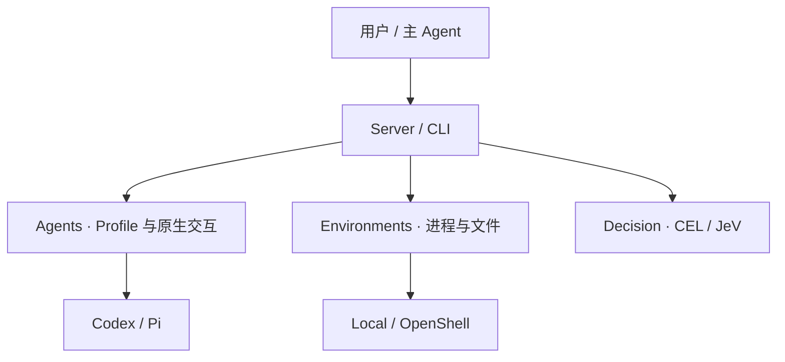

# Ordessa

**组合不同的 Agent Harness、运行环境与决策能力，让 Agent 接手实际工作。**

Ordessa 提供统一的 Server 和 CLI，管理 Agent 配置、运行实例与执行环境，并保留可查询的任务状态和事件。你可以使用熟悉的 Codex、Pi 等 Harness，通过原生协议提交任务，在 Local 或 OpenShell 环境中执行，再独立检查产出。

项目正在向**策略驱动的工作单元**发展：为工作者组合不同的配置、技能和知识，通过 Decision 判断任务是否接收、由谁执行，以及是否需要新的配置或环境。

> **当前状态：Foundation 1.0 已验收。** Codex / Pi、Local / OpenShell、CEL / JeV 与正式 Server/CLI 已有验证记录。组件化 Profile、自动选派和自动创建工作单元是下一阶段目标。

[快速开始](#快速开始) · [验证记录](#实际验证) · [发展方向](#发展方向) · [已知问题](docs/reference/known-issues.md)

## 核心能力

| 模块 | 负责什么 |
| --- | --- |
| **Agents** | Profile 固定版本、Harness 选择、实例生命周期与原生交互；复用原生协议中的细粒度接口 |
| **Environments** | 环境资源、进程与文件操作；Local 在本机执行，OpenShell 对接沙箱 |
| **Decision** | CEL 规则检查、JeV 判断与决策证据，可独立调用或由上层组合 |



提交任务后，客户端可以退出，再通过 `operationRef` 查询状态、按游标读取事件。执行结果无法确认时保留 `unknown`，不会默认重发。Agent 报告完成与独立验收通过分别判断。

## 实际验证

| 场景 | 结果 | 证据 |
| --- | --- | --- |
| Codex、Pi 分别实现日志统计功能 | 从相同未实现源码出发，各自完成修改；宿主独立验收均为 **19 passed**，测试文件未变 | [同任务实测](docs/verification/agent-work-20261022/README.md) |
| Codex、Pi 在 Local / OpenShell 中修复代码 | 四种组合均有真实修复记录，产出由宿主独立复核 | [Foundation 1.0](docs/verification/foundation-1.0-20261022/README.md) |
| 异步执行、取消与恢复 | 长任务快速受理、独立查询；停止与未知结果分别记录，重启不自动重派 | [验收范围](docs/verification/foundation-1.0-20261022/README.md#earlier-implementation-time-real-evidence) |
| CEL → JeV → CEL | 经正式入口完成混合决策，保存结果与用量证据 | [脱敏回执](docs/verification/foundation-1.0-20261022/receipts.json) |

这些结果覆盖列明的场景；完整桌面体验、真实审批回调及所有历史包不在同一验收范围。Local 不提供安全隔离，OpenShell 的有效隔离能力以具体环境与策略为准。

## 快速开始

当前提供源码安装。以下路径面向 Linux、Python 3.12，使用独立虚拟环境：

```sh
git clone https://github.com/mmm-05610/ordessa.git
cd ordessa
python3.12 -m venv .venv
. .venv/bin/activate
python -m pip install -r tooling/workspace/nightly-python-requirements.txt
python tooling/workspace/python_workspace.py --install
python -m pip install --no-build-isolation './packages/execution/environments[openshell]'
```

启动 Server：

```sh
ordessa-server --data-root /tmp/ordessa-demo/root --port 48765
```

在另一个已激活虚拟环境的终端发现能力：

```sh
ordessa --data-root /tmp/ordessa-demo/root list --json
ordessa --data-root /tmp/ordessa-demo/root agents harness list --json
ordessa --data-root /tmp/ordessa-demo/root describe agents.start --json
```

以上发现命令不调用模型。执行真实任务还需要安装对应 Harness、配置模型账户并准备环境；创建 OpenShell 沙箱需要可用的网关。Server 首次启动会生成实例 token，CLI 从指定数据根读取连接凭据。

完整命令用法见 [CLI 文档](apps/cli/README.md)；源码安装以本页和 [Python 工作区清单](python-workspace.json)为准。JavaScript / TypeScript 开发使用根目录 npm workspaces。

## 发展方向

1. **组件化 Profile**：组合并固定原生配置、指令、skills、知识快照和工具资源；记录实际加载与使用证据。
2. **策略驱动的工作单元**：组合 Agent、Environment 与准入策略，为任务选择合适的工作者；资源不足时提出创建方案。
3. **基于反馈改进配置**：关联配置版本与执行结果，支持候选配置的对比、采用和回退。

软件工程是其中一个应用方向：按明确方法审查设计充分性，再组织实施与验收。Engineering 上层目前冻结待重设计，尚未完成这条闭环；自动 Harness 自进化也尚未实现。

## 仓库导航

| 路径 | 内容 |
| --- | --- |
| [`apps/`](apps/) | CLI、Server、桌面入口与产品装配 |
| [`packages/execution/`](packages/execution/) | Agents、Environments、Decision 及保留的历史 Units 实现 |
| [`plugins/`](plugins/) | Harness、环境、决策与配置资源插件 |
| [`packages/interfaces/`](packages/interfaces/) | 渠道、传输与公开访问契约 |
| [`packages/engineering/`](packages/engineering/) / [`methods/`](methods/) | 工程对象、方法解释与方法资源 |
| [`tests/`](tests/) / [`docs/`](docs/) | 跨模块测试、设计与验收资料 |

开发前阅读 [AGENTS.md](AGENTS.md) 与[模块边界规范](docs/standards/engineering-standard.md)。CI 的必需检查覆盖当前支持的切片；历史失败仍记录在[已知问题](docs/reference/known-issues.md)，不代表全仓测试通过。精确检查命令见 [CI 工作流](.github/workflows/ci.yml)。

许可证见 [LICENSE](LICENSE)。第三方代码与资源保留各自的许可证和来源声明。
