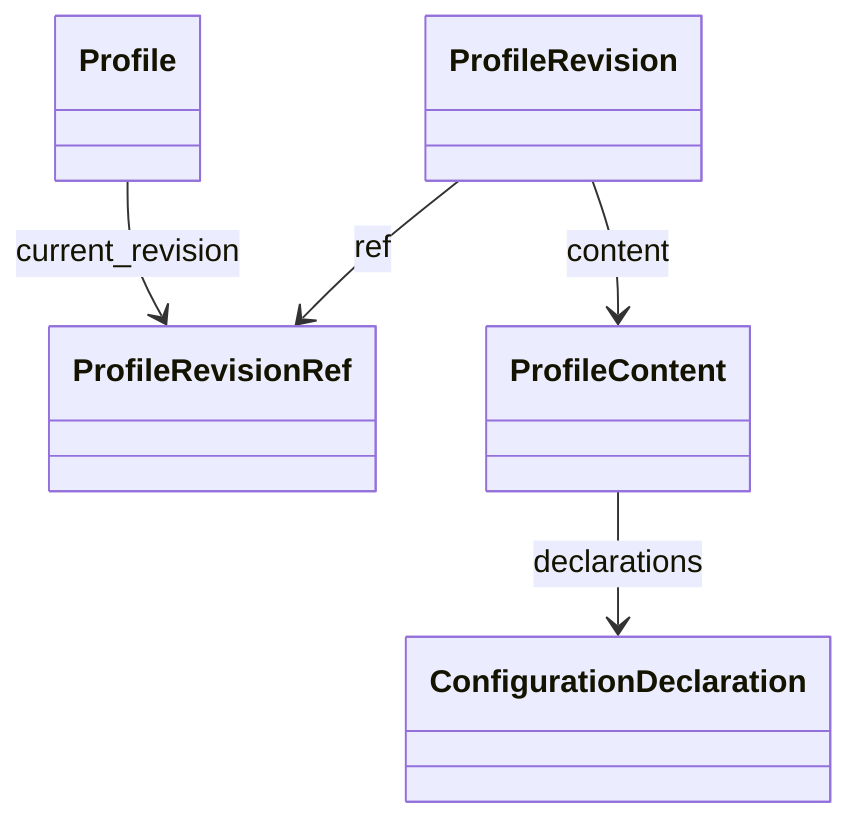

# Profiles（候选实现，待用户代码审阅）

结构与本轮数据模型命名/类型化方向已获用户批准；API与具体实现仍待用户代码审阅。
技术测试不等于用户验收。唯一服务是 execution distribution 内 management 的 `ProfileService`，
原 catalog 源码入口已删除，无转发或 fallback。

- **预置身份与管理状态**：`Profile(profile_id, version, name, archived_at, current_revision)`；
  `archived` 是从 archived_at 派生的只读布尔属性。version 是管理记录CAS版本，
  不等于内容revision；rename/archive等只追加管理版本。
- **精确内容修订**：`ProfileRevisionRef(environment_namespace, profile_id, revision, digest)`
  锁定环境、预置身份、内容版本与摘要。`ProfileRevision(ref, content)` 的 content 是唯一权威；
  content_json 是派生序列化属性，不能作为第二份内容传入或赋值。编辑追加新修订，历史固定引用不变。
- **配置意图**：`ProfileContent(schema_version, harness_definition_ref, declarations, metadata)`，
  declarations 为 ConfigurationDeclaration tuple。每项拥有 declaration_id、configuration_kind、
  schema_version、action、requirement、可选 payload/resource_refs。保留原 provider vocabulary
  与 opaque 引用，不猜 Harness 支持情况。
- **有边界的值**：payload 是递归 JSON union（null、bool、int、有限float、string、不可变mapping/tuple），
  不是任意 Python 对象。原最大深度32、完整内容字节数262144、声明数256及SecretRef规则保留。
  所有嵌套mapping均防御复制并冻结，arrays转tuple；编码返回独立dict/list，原始输入/输出的修改不影响修订。
  OMITTED、null、false、空数组/对象保持区别；resource_refs=None表示省略，空tuple表示显式[]；
  metadata=None表示省略，空mapping表示显式{}。不添加协议默认值。

`definitions/models.py` 定义唯一新模型；validation 复用原自身结构、重复项、非法组合、SecretRef、
边界与环境校验；codec 只将已读、已解析JSON映射为模型并反向编码。不文件IO、不存库、不写原生配置。
旧 Python 模型名 ProfileCatalogEntry/ProfileRef/ProfileManifest 已退休，没有别名或重复类定义。
public face 与仓内直接Python消费者成组使用新模型；这里确实改变了Python导出名称，不声称保留旧Python名称。

外部JSON及持久化字段保持：Profile.version/name/current_revision → catalogRevision/displayName/currentManifestRef；
ProfileRevisionRef.revision/digest → manifestRevision/contentDigest；ProfileRevision → {ref, content}。
完整字段映射见 definitions/README.md。原wire v1/v3与digest、历史canonical golden不变；
codec不迁移或重写历史数据库。

依赖方向为 management → definitions → 中性 Environment API；不依赖具体Unit、Harness或apps。
原store/SQLite所有者、Environment admission lock/policy/principal/fingerprint、request回放、CAS原子提交保留。
数据namespace仍是 agents.profile-catalog、agents.profile-manifests、agents.profile-snapshots；
ACL/request仍为 pacthold.agents.profiles.*。窄端口 `ProfileStorePort` 通过 `EnvironmentProfileStore` 接入同一个原store；
适配不导入SQLite、不建连接/库/ledger。最终存储适配归属待决，本候选没有扩大边界。

Unit准备/配置与provider读取只改新名称/字段和显式to_dict接线，权限、配置应用、生命周期保持原逻辑。
Unit publication/operation保持固定profileSnapshotRef，不随Profile.current_revision变化；
临时运行期配置改变不自动保存为预置。Harness继续负责原生转换、加载策略及热更/重启。
编码合法 ≠ Harness支持 ≠ 运行授权。原preview仍明确unresolved。

原生Harness ProfileStore旧链（claude-code/hermes/opencode → ordessa_server_product.harness_adapters.generic.profile_store）
属于范围外既有退役事项，本轮未改品牌配置机制；不能宣称全产品Profile权威已统一。

同步/来源与准确验证范围：docs/verification/profiles-20261009.json。审阅树仅含候选模块/相关测试快照，
未同步完整public/Unit/provider/Server及依赖和构建配置，不宣称独立可运行。没有真实库/模型/服务操作、git提交或push。

本轮小整理：JSON union、省略哨兵和冻结/解冻辅助的唯一定义在 `definitions/json_values.py`；
models只消费这些辅助，codec直接消费省略/解冻能力。业务模型/校验/协议行为未改。

显式公共入口为 `ordessa_execution_agents.profiles`，导出Profile模型、ProfileService、ProfileStorePort、
校验错误及content/revision的codec函数。入口只声明导出，不构造Environment、不注册/装配/执行IO；
aggregate `ordessa_units.public` 引用同一类与服务所有者。跨发行包不导入definitions/management内部。
codec解码明确接受已解析dict/list JSON，不声称支持任意Mapping或文件路径。

管理方法为create/list/get/get_revision/revise/rename/archive/restore/clone，以及既有stage_snapshot/preview。
修改参数为name/content/expected_version/base_revision；旧Python服务名与read/read_entry/edit方法已退休，
没有运行期转发。`compatibility.py`明确保留原namespace、capability、指纹事实键与revise→edit授权动作；
wire schema 声明（原v1/v3 schema）由各 owner 提供片段（纯 Profile 格式在 `profiles.definitions.schemas`，接入格式在 `harness.contracts.schemas`，实例管理格式在各 `units` owner），组合入口与 digest 在 `ordessa_units.public`；Server显式映射旧wire字段到新方法。
