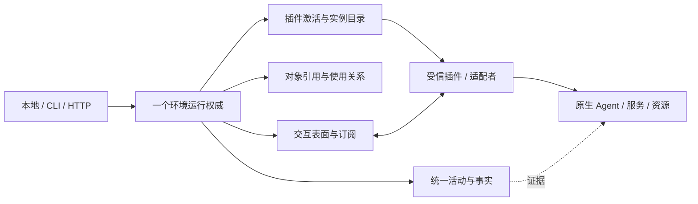

# V1 — 开放工作环境模型（攻击快照）

日期：2026-10-03。依赖 B1 边界；D1/D2 是候选分支，未得到用户裁决。本版是完整模型提案，不是生产合同。

## 先用一个例子

装入 Harness 插件，开两个原生 Agent 实例。每个实例拥有自己的会话与交互入口。创建会话的调用可以已经结束，但会话还活着；两个用户可以使用同一个会话，一个退出不会关闭另一个人的工作。环境内可以同时装入 Skills 资源插件与后台构建工具。移走 Agent 插件时，只撤销它贡献的入口；独立资源继续工作，历史保留且失联事实可见。



不是所有箭头都意味着核心执行内部工作：内核只管理实例声明交出的表面、对象和活动。

## 概念（名称可修订）

身份都带环境 ID E，避免不同数据根误认。永久 ID 不由展示名或文件路径决定。

| 概念 | 中文定义及非例 | 身份作用域 | 状态/关系 |
| --- | --- | --- | --- |
| Installation 安装单元 | 一份可装载实现及来源/版本/摘要；不是运行实例 | E + installation_id + digest | discovered/missing/installed/disabled；依赖/API 兼容声明 |
| Extension 插件激活 | 一次把实现贡献到环境的激活；不是外部服务 | E + plugin_id + activation_generation | staged/active/draining/retired/cleanup_failed |
| Participant 参与者实例 | 某插件承载的独立工作主体，含声明托管范围；不是一个能力函数 | E + instance_id + generation | starting/available/unreachable/retired；可本地或代理远端 |
| Surface 交互表面 | 插件声明的请求、流、双向入口或扩展点贡献；不是品牌功能枚举 | E + activation/instance + surface_id + contract_version | 发布/撤销；声明协议、结束条件、保障与权限 |
| Binding 绑定 | 将 selector 解析成固定实例/表面/版本/配置快照；不是动态名字查找 | E + binding_id；generation 与 digest 不可变 | active/revoked；活动开始后不重新选最新 provider |
| Activity 活动 | 环境入口的一次有相关性的操作及可知事实；不是原生会话或通道 | E + activity_id；调用者 request_key | accepted/dispatched/running/unknown/terminal；mode 决定何时结束 |
| Object 对象 | 被承载的长寿命可使用东西，可由创建活动返回；不是活动结果本身 | E + owner_instance/generation + object_id | available/unreachable/released/unknown；native locator 插件所有 |
| Ref 引用 | 对对象或历史事实的有类型 locator；不是权限/裸 native_id | E + kind + instance_generation + target_id | 解析须验证作用域/代际/可用性；历史 Ref 只读 |
| Usage 使用关系 | 某主体可使用某对象/贡献的许可；不是所有权 | E + usage_id，grantee 和 rights 固定 | active/released/expired/revoked；Lease 是有保留责任的 Usage |
| Observation 观察事实 | 某源在某时报告某种证据；不是自行成立的终态 | E + source_generation + observation_id | append-only；可信投影才能更新活动/对象 |
| Subscription 订阅 | 一个观察者收到有界事件的连接；不是对象所有者 | E + subscription_id + cursor_scope | open/gapped/closed；断开不停止活动或对象 |

Extension 可以启多个 Participant；一个 Participant 有多个 Surface/对象。Capability 是 Surface 的描述和匹配视图，不新增另一个运行主体/注册权威。Execution 仅保留为 Activity 的旧入口适配名，不把对象也叫 Execution。

## 公共契约草案

```text
Environment.discover(manifest) -> InstallationFact
Environment.activate(installation, contributions) -> Activation
Environment.instantiate(activation, request) -> Activity -> ParticipantRef
Environment.bind(selector, context, required_guarantees) -> Binding
Environment.invoke(binding, input, request_key, options) -> ActivityReceipt
Environment.open_interaction(binding, options) -> ActivityReceipt + ObjectRef
Environment.use(ref, rights, grantee) -> Usage
Environment.release(usage) -> ReleaseFact
Environment.destroy(object_ref, authority) -> ActivityReceipt
Environment.observe/activity_query(ref) -> FactView
Environment.subscribe(ref, cursor, quota) -> Subscription
Environment.request_cancel(activity_ref, request_key) -> CancelRequestFact
Environment.reconcile(ref) -> EvidenceFact
Environment.drain(activation_or_instance) -> Blockers
Environment.retire(ref) -> RetirementReport
```

这些是概念入口，不限定同步/async Python 签名。所有用户能力调用都经 invoke admission；Environment 的账本读写/索引维护为内部 primitive，不再套一层 Activity。用户主动调用 query/reconcile 则创建轻量或有保障活动，不递归记账。

Surface 声明至少包含 owner/generation、contract_version、payload_schema 或 opaque_codec、mode（one_shot/task/interaction/stream）、effect_domain（read/local/external/native_internal）、max_input/output/inflight、ordering、reconcile/idempotency 能力、rights、安全敏感度、配置生效范围、finish_evidence_kind。
未知业务字段留在 opaque payload；固定 envelope 控制身份、相关性、大小和通道类型。

## 活动状态与结束条件

```text
accepted -> dispatched -> running -> terminal(success|failure|cancelled|refused)
                 |           |
                 +-> unknown <-+
unknown -> running | terminal （仅核对证据）
cancel_requested 是独立事实，deadline_exceeded 是观察事实。
```

one_shot 在具有语义完整的返回时结束；task 在插件报告任务证据时结束；interaction 的打开活动以 handle 接受结束，对象持续存在，随后每次环境发送/调用有活动；stream 的打开活动以流句柄接受结束，订阅结束不算生产者结束。原生一条内部消息或内部 tool call 不必是环境活动。

- terminal 不可重写。晚到冲突证据追加并标 conflict，不倒改已见事实；是否影响当前事实需核对。
- 取消请求与取消确认独立；取消和完成竞争，内核串行接受第一个经身份校验的 terminal，另一个保留 conflict，不能将 request_cancel 直接当 cancelled。
- deadline 不停止外部副作用；失联只更新可知状态。unknown 禁止自动重新发送可能有效的副作用。
- 同一 activity 可链接 outputs:ObjectRef、parent_activity_id、native_correlation、work_context_ref；这些关联不夺取原生内部权威。

## 保障与成本分离

所有活动有 admission、绑定快照、相关性、typed refusal、有界记录与事件。读查询默认内存，保障存续范围为本次环境代际/TTL，不需要 Store 或 Lease；请求跨重启去重/审计时选 durable。
托管外部副作用必须 durable intent，在发出前提交；原生交互内部效果明确留在 native_internal，环境只承诺入口接收/发送的证据，不承诺模型内部效果 exactly-once。
若调用要求 durable，而没有 Store 或 surface 没有必要证据，发出前 refuse；不是静默退成 memory。

请求去重 `(E, principal, surface, request_key)`：同键同 input/binding digest 返回原回执，不再次调用；同键异输入/绑定拒绝。环境计算 digest，不信调用者自述；过期去重明确返回 expired，不能无限保证。
Lease 仅用于声明需要占用/互斥/持有责任的对象，查询可以不申请。对象元数据可持久而消息流只内存。

## 崩溃窗口与恢复

| 崩溃位置 | 环境知道什么 | 恢复 |
| --- | --- | --- |
| 意图提交前 | 无 accepted durable 活动；禁止发送 | 新请求正常准入；不能断言用户原生侧没有其他工作 |
| 意图后/发送前 | accepted/dispatched，未必已发 | 只在可证明未发时继续，否则 unknown |
| 发出后/回执前 | 可能外部已生效 | unknown，查询同代际原生 operation token；无证据不重发 |
| 回执到/结果提交前 | durable 仍未知 | 核对；不能凭失去的内存回执恢复 success |
| 结果提交后/回给客户端前 | 有 durable 结果 | 同键重放同结果，零调用 |

reconcile 不暗含 spawn/login/reconnect/reissue；它是插件声明可安全查询的能力。缺查询则保持 unknown，给用户可见未决和移除 blocker。

## 对象、引用、共享和配置

创建活动终结≠对象结束。管理权 owner 属实例；destroy 需要独立 destroy right 和策略许可；借用对象不可由 release 毁掉。一个 Usage 释放只减自己使用关系；最后使用者退出不自动毁对象，除非创建声明 idle_dispose 且 owner 确认。
Ref 不是秘密凭证；解析后每次检查 caller rights 和 generation。native locator 只在插件/可信 secret port，历史只存安全摘要和外部事实引用。
配置 revision 固定在 Binding；允许新调用/新实例/显式 apply 的范围分别声明。进行中活动不吃 latest 配置；原生自行变化要被报告，不能假装受内核固定。

## 激活、组合与移除

先验证整个依赖图、冲突和 API 版本；stage 不发布，commit 一次发布所有贡献。插件启动若已有外部效果，rollback 只能做安全补偿并保留残留对象/cleanup_failure，不能叫「无任何副作用」。
组合活动固定 DAG，资源依赖按序、同对象按声明读写并发；父子 cancel 不自动传播，按声明范围请求；子部分成功，父不能声称外部事务已回滚。阻塞依赖缺失明确 refuse，循环拒绝。

drain 关闭新准入，允许已持有活动完成/核对；blockers 包括运行中/unknown activity、Usage、对象销毁未确认、inflight contribution hold、active dependents。D2 默认建议：有 blocker 则 retire 拒绝；单实例退出不影响同插件其他实例。实现卸载在插件全体实例退役后；历史 schema 中性且 reader 不依赖原代码。
重装同名同版本也产生新 activation/instance generation；旧 Ref/late event 不得控制新实例。新旧版本可并存不同 generation；现有活动不在运行期间替换绑定。显式恢复需兼容声明与证据，不冒认旧活动。

## 未知原生命令、事件与安全

D1 建议分支：环境授权入口/实例/原生会话范围，插件保持 native approval；已有透明命令入口能透传 `/workflow` 无核心 API 更新。上游新增 native-only UI 则报告 adapter_gap，不能说零适配可用。
每帧经过限额/来源/代际/相关性检查，payload 不按命令白名单裁剪。未知类型显示 raw-safe/下载受权限保护的证据，不能当 permission 或终态；未知需要应答的控制帧须由 owning adapter 处理，不自动同意。
采用每订阅有界队列、序号、gap 标志、断开；控制消息不能静默丢弃，无法送达要显式失败/unknown。无限流有预算和 pause/detach；不擅自 kill producer。
不持久化 secret payload；未知内容不得自动插入 HTML/执行命令/跨 scope 路由。trusted in-process plugin 无恶意代码隔离保证；远端/隔离组件仍受接口鉴权。

## 合法与非法序列（各概念反例）

| 概念 | 合法 | 非法 |
| --- | --- | --- |
| Installation | 安装摘要A→校兼容→激活 | 缺实现仍报告 available |
| Extension | stage 全验→单次 publish→drain→idle retire | 发布一半再发现冲突 |
| Participant | 一个 plugin→I1/I2→I1退役，I2继续 | 用 plugin_id 代替 instance_id 杀全部 |
| Surface | owner发布→caller授权→调用→撤销 | 路由有 handler 而 owner 已移除仍调用 |
| Binding | 解析v1/g1→invoke固定g1 | 一半请求重选v2/g2 |
| Activity | 提交意图→调用→结果证据→终态 | timeout→cancelled 或未知→重发 |
| Object | create终态→两用户使用→U1退出，U2继续 | create活动结束销毁对象 |
| Ref | 校E/g/right→resolve | native_id 或 stale ref直接控制 |
| Usage | obtain use-only→release自己 | 借用者 release变destroy |
| Observation | g1 seq1/seq2→追加冲突 | g1晚到更新g2 |
| Subscription | attach→gap→detach，对象仍活 | 断网→对象cancelled |

## 五类完整接入例子

纸面例子；未装载任何真实资产或运行模型。

| 参与者 | 安装/实例化 | 交互与核心/插件分工 | 更新 | 移除 |
| --- | --- | --- | --- | --- |
| 原生 Agent（Codex） | Harness installation；adapter 建实例I与原生入口；create session 活动返回对象S | 核心管理I/S/usage及入口活动；插件协议/启动/审批/原生推理；S多轮，不镜像内部workflow | 新命令在已承载入口直达；revision新调用，旧S按原生声明；UI专属报gap | drain、停止需插件证据；detach不等stop；历史安全 locator留存 |
| 持续工具服务（MCP） | MCP适配插件；远端绑定或托管本地服务实例，各自持有权声明 | 通用交互表面含动态 tools 请求/通知；插件理解 MCP；核心只管入口/对象/活动 | tools_changed 属native schema变化，固定本次 binding，未知工具名可由原生入口消费 | 远端borrowed不kill；托管服务核对并销毁；单客户端断开仅去usage |
| 资源业务（Skills） | 资源插件安装；catalog instance；Skill版本对象 | read/list轻活动；resolve返回不可变内容引用，插件校路径/内容；无需Harness/Profile | 新内容新digest，新binding，新旧版本并存 | 拒绝被使用版本的破坏性删除；移插件后中性历史可读，正文读取缺实现明示 |
| 短外部命令 | 命令adapter；受信启动规格，执行实例 | invoke durable intent→exit证据；stdout流非exit；核心不把任意字符串当shell | 新命令 spec产生新binding；进行中不替换 | 退出有证据后retire，unknown保留；cleanup不改主失败 |
| 后台长期工具 | 构建/watch插件；start活动完成，job对象J继续 | 返回J；subscribe观察，status轻查询；取消须stop evidence | 新配置仅新job或显式受控apply | 断订阅不kill；owner请求stop，确认后退役；共享use release不终止 |

## V1 要求攻击者挑战的薄弱点

尤其挑战跨线程事务、取消冲突真实性、release/destroy 与使用竞态、activation 与独立实例权限、opaque流 durable 边界、unknown控制帧/背压、卸载全链 pin、旧历史无插件读取，以及恢复代际兼容。没有证明这些闭合；不能以表格覆盖当通过。
