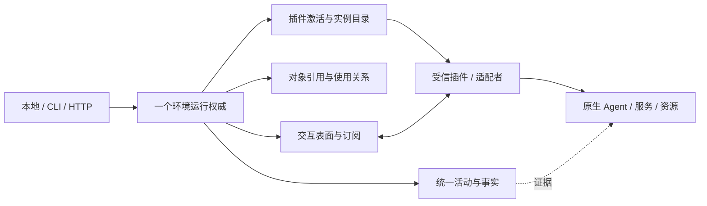

# V3 — 开放工作环境模型（候选修订）

日期：2026-10-03。D1/D2已确认；D4/D5/D6相关选择待答时只列条件提案，不自动生效。两轮攻击见 attacks/round-1.md、round-2.md。本文为独立完整候选，V2-n为继承规则，V3-n明确覆盖其冲突处；已完成独立复查及主验收A-01/A-02修订，详情见review，不是生产实现/冻结合同。

## 先用一个例子

装入 Harness 插件，开两个原生 Agent 实例。每个实例拥有自己的会话与交互入口。创建会话的调用可以已经结束，但会话还活着；两个用户可以使用同一个会话，一个退出不会关闭另一个人的工作。环境内可以同时装入 Skills 资源插件与后台构建工具。移走 Agent 插件时，只撤销它贡献的入口；独立资源继续工作，历史保留且失联事实可见。



不是所有箭头都意味着核心执行内部工作：内核只管理实例声明交出的表面、对象和活动。

## 概念（名称可修订）

身份都带环境 ID E，避免不同数据根误认。永久 ID 不由展示名或文件路径决定。

| 概念 | 中文定义及非例 | 身份作用域 | 状态/关系 |
| --- | --- | --- | --- |
| Installation 安装单元 | 一份可装载实现及来源/版本/摘要；不是运行实例 | E + installation_id + digest | discovered/missing/installed/disabled；依赖/API 兼容声明 |
| Extension 插件激活 | 一次把实现贡献到环境的激活；不是外部服务 | E + plugin_id + activation_generation | staged/active/draining/retired/cleanup_failed |
| Participant 参与者实例 | 某插件承载的独立工作主体，含声明托管范围；不是一个能力函数 | E + instance_id + generation | starting/available/unreachable/retired；可本地或代理远端 |
| Surface 交互表面 | 插件声明的请求、流、双向入口或扩展点贡献；不是品牌功能枚举 | E + activation/instance + surface_id + contract_version | 发布/撤销；声明协议、结束条件、保障与权限 |
| Binding 绑定 | 将 selector 解析成固定实例/表面/版本/配置快照；不是动态名字查找 | E + binding_id；generation 与 digest 不可变 | active/revoked；环境轴固定，原生轴按保障声明；不重新选 provider |
| Activity 活动 | 环境入口的一次有相关性的操作及可知事实；不是原生会话或通道 | E + activity_id；调用者 request_key | admission/delivery、当前结论、取消事实分轴；mode 决定证据要求 |
| Object 对象 | 被承载的长寿命可使用东西，可由创建活动返回；不是活动结果本身 | E + owner_instance/generation + object_id | reserved/available/closing/released/unreachable/unknown；管理责任分轴 |
| Ref 引用 | 对对象或历史事实的有类型 locator；不是权限/裸 native_id | E + kind + 完整typed target identity；ObjectRef为E + Object + owner_instance_id + owner_generation + object_id | 解析须验证完整身份、作用域/代际/可用性；历史 Ref 只读；缺实例ID的旧Ref不能用于当前控制 |
| Usage 使用关系 | 某主体可使用某对象/贡献的许可；不是所有权 | E + usage_id，grantee 和 rights 固定 | active/released/expired/revoked；Lease 是有保留责任的 Usage |
| Observation 观察事实 | 某源在某时报告某种证据；不是自行成立的终态 | E + source_generation + observation_id | append-only；可信投影才能更新活动/对象 |
| Subscription 订阅 | 一个观察者收到有界事件的连接；不是对象所有者 | E + subscription_id + cursor_scope | open/gapped/closed；断开不停止活动或对象 |

Extension 可以启多个 Participant；一个 Participant 有多个 Surface/对象。Capability 是 Surface 的描述和匹配视图，不新增另一个运行主体/注册权威。Execution 仅保留为 Activity 的旧入口适配名，不把对象也叫 Execution。

## 公共契约草案

```text
Environment.discover(manifest) -> InstallationFact
Environment.activate(installation, contributions) -> Activation
Environment.instantiate(activation, request) -> Activity -> ParticipantRef
Environment.bind(selector, context, required_guarantees) -> Binding
Environment.invoke(binding, input, request_key, options) -> ActivityReceipt
Environment.open_interaction(binding, options) -> ActivityReceipt + ObjectRef
Environment.acquire_use(ref, requested_rights) -> Usage  # 仅本人，owner策略决定可授予权利
Environment.release(usage) -> ReleaseFact
Environment.destroy(object_ref, authority) -> ActivityReceipt
Environment.observe/activity_query(ref) -> FactView
Environment.attach_interactor(object_ref, role, quota) -> Interactor
Environment.reply(control_ref, reply_hold, payload, request_key) -> DeliveryReceipt
Environment.subscribe(ref, cursor, quota) -> Subscription
Environment.request_cancel(activity_ref, request_key) -> CancelRequestFact
Environment.reconcile(ref) -> EvidenceFact
Environment.drain(activation_or_instance) -> Blockers
Environment.retire(ref) -> RetirementReport
```

这些是概念入口，不限定同步/async Python 签名。所有用户能力调用都经 invoke admission；Environment 的账本读写/索引维护为内部 primitive，不再套一层 Activity。用户主动调用 query/reconcile 则创建轻量或有保障活动，不递归记账。

Surface 声明至少包含 owner/generation、contract_version、payload_schema 或 opaque_codec、mode（one_shot/task/interaction/stream）、effect_domain（read/local/external/native_internal）、max_input/output/inflight、ordering、reconcile/idempotency 能力、rights、安全敏感度、配置生效范围、finish_evidence_kind。
未知业务字段留在 opaque payload；固定 envelope 控制身份、相关性、大小和通道类型。

## 活动状态与结束条件

```text
admission: reserved -> accepted | refused
delivery: not_issued -> claim_reserved -> issue_possible -> acknowledged | unknown
current conclusion: pending | running | unknown | concluded(outcome) | disputed
issued Receipt 为不可变历史，current conclusion 可凭核对证据追加新版本。
cancel_requested、cancel_accepted、stop_confirmed 分账；deadline_exceeded不产生终态。
```

one_shot 在具有语义完整的返回时结束；task 在插件报告任务证据时结束；interaction 的打开活动以 handle 接受结束，对象持续存在，随后每次环境发送/调用有活动；stream 的打开活动以流句柄接受结束，订阅结束不算生产者结束。原生一条内部消息或内部 tool call 不必是环境活动。

- 已发Receipt/原始证据不可改写；当前结论是带revision的投影。可信矛盾进入disputed并阻塞管理退出，核对后追加新结论，不覆盖旧记录。
- 不采用“第一到达terminal胜出”。权威证据需target/token/owner/source序号及finish语义；取消接收不等停止确认，详见V2-3。
- deadline 不停止外部副作用；失联只更新可知状态。unknown 禁止自动重新发送可能有效的副作用。
- 同一 activity 可链接 outputs:ObjectRef、parent_activity_id、native_correlation、work_context_ref；这些关联不夺取原生内部权威。

## 保障与成本分离

所有活动有 admission、绑定快照、相关性、typed refusal、有界记录与事件。读查询默认内存，保障存续范围为本次环境代际/TTL，不需要 Store 或 Lease；请求跨重启去重/审计时选 durable。
托管外部副作用及向原生入口的效果性发送都必须 durable intent，在发出前提交；内部效果仍留在 native_internal，环境只承诺入口接收/发送事实，不承诺模型内部效果 exactly-once。无需Store的入口限经声明的只读查询/内存观察；不把副作用发送偷偷降为memory。
若调用要求 durable，而没有 Store 或 surface 没有必要证据，发出前 refuse；不是静默退成 memory。

请求去重 `(E, principal, logical_surface, request_key)`：唯一占位、摘要核对、Activity创建同事务；包括固定Binding身份。并发只有一个dispatch claim；同键同digest返回原回执，异digest拒绝。环境计算digest，不信调用者自述。durable去重保留安全墓碑，不将过期副作用键变新请求；memory请求绑定epoch/TTL，过期明确expired。
Lease 仅用于声明需要占用/互斥/持有责任的对象，查询可以不申请。对象元数据可持久而消息流只内存。

## 崩溃窗口与恢复

| 崩溃位置 | 环境知道什么 | 恢复 |
| --- | --- | --- |
| 意图提交前 | 无 accepted durable 活动；禁止发送 | 新请求正常准入；不能断言用户原生侧没有其他工作 |
| 意图后/发送前 | accepted/dispatched，未必已发 | 只在可证明未发时继续，否则 unknown |
| 发出后/回执前 | 可能外部已生效 | unknown，查询同代际原生 operation token；无证据不重发 |
| 回执到/结果提交前 | durable 仍未知 | 核对；不能凭失去的内存回执恢复 success |
| 结果提交后/回给客户端前 | 有 durable 结果 | 同键重放同结果，零调用 |

reconcile 不暗含 spawn/login/reconnect/reissue；它是插件声明可安全查询的能力。缺查询则保持 unknown，给用户可见未决和移除 blocker。

## 对象、引用、共享和配置

创建活动终结≠对象结束。管理责任属owner实例；destroy需独立权利/策略及原子closing门，借用对象不可由release毁掉。一个Usage释放只减自己；最后使用者退出不自动毁对象。未来idle_dispose若声明须走同一closing栅栏，不依赖一次看到使用数为零。
Ref 不是秘密凭证；解析后每次检查 caller rights 和 generation。native locator 只在插件/可信 secret port，历史只存安全摘要和外部事实引用。
环境配置revision固定在Binding；原生desired/observed/enforced另轴。不支持compare-and-invoke时不得承诺执行配置固定，调用者要求强保证则拒绝。原生自主变化可被报告，不偷改环境快照，不把旧快照当已执行证明。

## 激活、组合与移除

先验证整个依赖图、冲突和 API 版本；stage 不发布，commit 一次发布所有贡献。插件启动若已有外部效果，rollback 只能做安全补偿并保留残留对象/cleanup_failure，不能叫「无任何副作用」。
组合活动有无环父子/资源依赖图，运行期新增子调用按同一准入验证；等待图独立检查，不把DAG当无死锁证明。框架锁不跨插件代码；无声明同步重入拒绝。父子取消只按明示范围请求；部分结果和cleanup独立，不承诺外部原子性。

drain 关闭新业务准入，保留限定既存目标的closure（核对/停止/释放/证据）入口；blockers包括未发布/存储不可读/冲突义务、所有活owned对象、活动pin、Usage、reply hold、依赖。用户D2确认正常移除先等工作结束/确认停止；立即脱管需另明确要求。borrowed对象仅解除本方关系，历史不pin；退出归宿和scope完整性必须逐项解释。
重装同名同版本也产生新 activation/instance generation；旧 Ref/late event 不得控制新实例。新旧版本可并存不同 generation；现有活动不在运行期间替换绑定。显式恢复需兼容声明与证据，不冒认旧活动。

## 未知原生命令、事件与安全

D1 已确认：环境授权入口/实例/原生会话范围，插件保持 native approval；已有透明命令入口能透传 `/workflow` 无核心 API 更新。上游新增 native-only UI 则报告 adapter_gap，不能说零适配可用。
每帧经过限额/来源/代际/相关性检查，payload 不按命令白名单裁剪。未知类型显示 raw-safe/下载受权限保护的证据，不能当 permission 或终态；未知需要应答的控制帧须由 owning adapter 处理，不自动同意。
采用每订阅有界队列、序号、gap 标志、断开；控制消息不能静默丢弃，无法送达要显式失败/unknown。无限流有预算和 pause/detach；不擅自 kill producer。
不持久化 secret payload；未知内容不得自动插入 HTML/执行命令/跨 scope 路由。trusted in-process plugin 无恶意代码隔离保证；远端/隔离组件仍受接口鉴权。

## 合法与非法序列（各概念反例）

| 概念 | 合法 | 非法 |
| --- | --- | --- |
| Installation | 安装摘要A→校兼容→激活 | 缺实现仍报告 available |
| Extension | stage 全验→单次 publish→drain→idle retire | 发布一半再发现冲突 |
| Participant | 一个 plugin→I1/I2→I1退役，I2继续 | 用 plugin_id 代替 instance_id 杀全部 |
| Surface | owner发布→caller授权→调用→撤销 | 路由有 handler 而 owner 已移除仍调用 |
| Binding | 解析v1/g1→invoke固定g1 | 一半请求重选v2/g2 |
| Activity | 提交意图→调用→结果证据→终态 | timeout→cancelled 或未知→重发 |
| Object | create终态→两用户使用→U1退出，U2继续 | create活动结束销毁对象 |
| Ref | 校E/g/right→resolve | native_id 或 stale ref直接控制 |
| Usage | obtain use-only→release自己 | 借用者 release变destroy |
| Observation | g1 seq1/seq2→追加冲突 | g1晚到更新g2 |
| Subscription | attach→gap→detach，对象仍活 | 断网→对象cancelled |

## 五类完整接入例子

纸面例子；未装载任何真实资产或运行模型。

| 参与者 | 安装/实例化 | 交互与核心/插件分工 | 更新 | 移除 |
| --- | --- | --- | --- | --- |
| 原生 Agent（Codex） | Harness installation；adapter 建实例I与原生入口；create session 活动返回对象S | 核心管理I/S/usage及入口活动；插件协议/启动/审批/原生推理；S多轮，不镜像内部workflow | 新命令在已承载入口直达；revision新调用，旧S按原生声明；UI专属报gap | drain、停止需插件证据；detach不等stop；历史安全 locator留存 |
| 持续工具服务（MCP） | MCP适配插件；远端绑定或托管本地服务实例，各自持有权声明 | 通用交互表面含动态 tools 请求/通知；插件理解 MCP；核心只管入口/对象/活动 | tools_changed 属可变native目录，Binding固定环境运输轴；未知工具名可由原生入口消费，原生执行revision另报 | 远端borrowed不kill；托管服务核对并销毁；单客户端断开仅去usage |
| 资源业务（Skills） | 资源插件安装；catalog instance；Skill版本对象 | read/list轻活动；resolve返回不可变内容引用，插件校路径/内容；无需Harness/Profile | 新内容新digest、新binding；本次读结果不可变，新旧版本并存 | 拒绝被使用版本的破坏性删除；移插件后中性历史可读，正文读取缺实现明示 |
| 短外部命令 | 命令adapter；受信启动规格，执行实例 | invoke durable intent→exit证据；stdout流非exit；核心不把任意字符串当shell | 新命令 spec产生新binding；进行中不替换 | 退出有证据后retire，unknown保留；cleanup不改主失败 |
| 后台长期工具 | 构建/watch插件；start活动完成，job对象J继续 | 返回J；subscribe观察，status轻查询；取消须stop evidence | 新配置仅新job或显式受控apply | 断订阅不kill；owner请求stop，确认后退役；共享use release不终止 |

## 候选独立复查关注点

尤其挑战跨线程事务、取消冲突真实性、release/destroy 与使用竞态、activation 与独立实例权限、opaque流 durable 边界、unknown控制帧/背压、卸载全链 pin、旧历史无插件读取，以及恢复代际兼容。V2规则继承第一轮修复，V3规则处置第二轮；独立复查必须检查完整契约，不以表格覆盖当通过。

## V2-1 管理义务与退役闭合

Obligation（管理义务）不是新执行主体，是已承诺责任的索引：目标Ref、owner activation/instance generation、kind、证据位置、当前unresolved/resolved/disputed、最小解决入口。kind包括未发布启动、活owned对象、未知投递/清理、冲突结果、inflight调用、使用保留、交互应答、实现依赖。索引由唯一事实账生成，不能双写第二套运行主状态。
对象声明 management=owned/borrowed；delegated仅在有已授权新owner与移交证据后存在。只有管理义务已证据解决才允许删除实现。available/closing/unreachable/unknown 的owned运行对象即使无人用也阻塞退役；静态资源按V3-10的预声明关系退出合同判定，不能隐式当destroy。borrowed仅释放本环境Usage/控制绑定，不销毁远端；历史released对象不占pin。
drain返回每项blocker/closure action/所需授权/实现pin，不做自动stop或无限自动等待。没有可安全核对入口即保持unknown，并说明正常移除尚未完成；D2不授权强制清理或脱管。已结束但发现未枚举原生范围也不得报全停。
Store不能读时退出门为unknown/refuse，不能把空内存集合当无blocker。

## V2-2 生命周期准入与原子门

一个环境generation的lifecycle gate排序：贡献发布/撤销、实例准入/drain、对象use/closing、权限撤销、invoke短pin、退役。门内只查/改元数据和必要原子持久事务，不运行插件callback/外部I/O；跨持久/内存发布使用预验证＋提交可见revision，失败先关准入并保留义务。
invoke准入原子检查caller授权、Binding/generation可用、对象未closing、业务/closure类别，取得InvocationPin并登记activity/claim。Pin覆盖实际调用、异步完成所需实现和结果编码，不要求长期Lease/DB。若返回延迟正文或流，必须成为独立Object/Activity/Subscription生命周期，不能在pin释放后偷偷读取卸载实现。
use签发只在available且门未关时成功；destroy/idle-dispose检查Usage/pin/dependents并原子转closing，关新use/invoke，再提交durable意图，门外调用。默认活Usage时destroy拒绝。失败/失联转unknown/cleanup_failed，不回available，只有核对证据才恢复；不猜测destroy未发生。
draining拒业务新工作，closure范围在D4待答时仍只列方案；若用户允许收尾链，则按V3-6的admission cut/根责任因果链校验cancel/reconcile/release/destroy/evidence/reply/必要依赖读与显式重新attach；其代码pin直到义务解决。closure不能启动新的业务意图或扩大授权；已接受活动的晚到结果身份和必要交互按V3-6区分，不以“新Ref”一律拒绝。关闭表面不应先剥掉清理实现。
并发正例：use先胜→destroy拒；closing先胜→use拒。非法：查零Usage→放门→并发签发Usage→按旧快照destroy。

## V2-3 证据、终态与可纠正知识

Evidence含 `(E,target_ref, native_incarnation, operation_token, observer_generation, owner_role, authority_domain, source_revision, kind, scope_coverage, safe_summary)`。transport收帧≠owner效果证据；未知payload不具有evidence角色。
证据source/local/native/current序号按V3-4比较。每个Surface声明权威域和充分finish证据：one_shot返回结果、task任务完成、open只表示句柄接受、delivery只表示入口接收；取消accept只记录请求受理，stop_confirmed仅覆盖证据明示的管理范围。
同一声明的可比较native source/epoch单调revision：重复同内容去重，同revision异内容disputed；晚到较旧版本留原始证据但不改变新投影；没有序号或总序证据的相互矛盾结果必须disputed，不能凭arrival任选。跨权威域不强排因果，只有adapter声明的合并规则可产生当前结论；缺规则unknown。
Receipt是“当时发出的答复”，永不覆写；CurrentFact revision可从concluded转disputed，经专属核对追加concluded修正。每次query同时返回原receipt、当前revision/outcome、conflict/obligation，不把重放旧receipt呈现为当前最终真相。旧持久terminal字段不改枚举，迁移读层附加纠正事实；这种附加数据仍需后续迁移批准。
退役只看管理义务，不能仅凭receipt terminal。证明cancelled要求原生操作已停止且scope足够；不推导没有历史副作用。

## V2-4 嵌套调用与等待

安装依赖图、组合父子/资源图、运行等待图三图不同。父子关系只是相关性，不自动转授权限/取消/继承原生内部责任。
环境调用上下文包含principal、授权缩限、ancestry、depth/budget、held reservation集合，不能由payload自造。插件调其他Surface经同invoke，默认异步receipt，不持框架锁同步等callback。
若Surface声明允许阻塞嵌套，需声明资源全序且检查held→requested排序；倒序/重入冲突typed refusal。未知资源模式不承诺阻塞组合，返回would_block而非占满槽位等待。父子活动可动态新增，但加入前查scope/depth/预算/图环；超过预算拒绝。原生内部等待图不受托管，不伪称解决原生死锁。
部分成功返回子结果、primary cause、cleanup facts；失败不擦除已产生对象和义务。父取消不证明子停止；子可独立background必须声明owner。

## V2-5 权限与使用关系

Ref只能定位。普通acquire_use(ref,requested_rights)仅向已验证caller本人申请，签发由owner policy port决定，rights不超caller已获上限/对象策略；destroy与grant是独立权利，不因拥有Ref/use而获得。
本模型不开放caller任意grantee的转授API。未来共享邀请需owner/业务授权端口签发受限Usage，不改变核心授权判定；未授权转授拒绝。释放仅Usage主体或有release-management权者可做；操作目标和权利在生命周期门下校验，旧Usage/撤权不能经缓存Binding绕过。
入口授权D1限定instance/surface/object及角色。全局配置引用/身份引用不携带秘密，也不自动扩展workspace/系统权限。网络、CLI、本地principal经统一验证映射，不能body自述principal。
进程内插件仍受信任，此机制没有保护恶意Python插件直接OS访问的隔离保证。

## V2-6 Binding固定轴与原生可变轴

固定：E、logical surface、activation/instance generation、adapter digest、transport contract、environment context/revision、grants引用、保障要求。Binding不是将权限永久冻结：每次invoke复核撤权。
native轴：desired revision、observed revision/时间、enforced revision（可unknown）、dynamic catalog cursor、native incarnation。只有插件/原生支持原子compare-and-invoke/version-pin才有enforced；单独preflight查询存在TOCTOU，不能升级成强保证。
原生开放入口默认允许其原生动态状态，环境明确标observed-only，保留原生自主权；调用者required_enforced_revision却无支持时准入前refuse，不降级。如果内部状态在接受后变化，历史记实际可知revision/unknown，不倒写环境快照。动态目录新增能力不需改Core Surface；已接受同key重放原结果零新调用，已删除tool的新调用原生拒绝。
这不是新增强制native配置策略；固定的是能固定的环境轴。原生live apply仍由adapter声明可影响范围、实际证据和unknown结果。

## V2-7 意图、原生投递与去重

stage只做纯描述准备，不启动资产；必要的外部prepare/instantiate/open/destroy/native-send都作为显式托管活动，先有durable intent和临时generation/token。callback若背约启动未声明效果，属于受信插件违约，环境不得声称隔离/完整管理。
durable admission事务：校授权/版本＋唯一key占位＋安全input/binding digest＋Activity/Obligation记录；只有commit成功方可取得单一dispatch claim。claim在发出前持久为issue_possible；崩溃后该状态只能unknown/核对，不按“尚无回执”判断没发。CAS/Store锁域覆盖完整事务；同一环境只有一个writer runtime，重启复核数据根所有权。不得多runtime竞争产生独立claim。
副作用key安全墓碑保留拒重试所需字段（scope/key fingerprint/digest/target/结果位置），重装不清去重。附加对象generation是摘要字段，不能将同key换新generation视作新操作。过期结果可以unavailable，保留key spent，不自动重发；用户新意图用新key。
只读memory query key带环境epoch/TTL，旧epoch返回expired。未知effect声明不得默认read。无Store仍能启动与读/观察，但效果性native-send/external start要求durable，缺Store明确refuse。这不要求全量原生流量持久：只记环境发出的effectful入口请求安全意图/receipt，内部tools/events无需逐帧DB。
未发布启动崩溃也有stage attempt/临时generation义务，查询无identity时orphan_possible不消失；不按裸PID/path推断归属，不自动重启或kill。

## V2-8 跨代际只读核对

native incarnation独立于adapter generation：受信owner提供不可复用native身份或明确不可证明；PID/path/session展示名不够。新observer可经RecoveryBinding读取旧activity/token，但不成为旧owner。
RecoveryBinding包含旧target、old native identity、operation token/intent、new observer digest/generation、协议兼容摘要、scope=read-evidence、授权依据。核对源/回包仍在调用前后验证目标未变；refused/error路径也复查，旧归属已失效则不可将拒绝当新实例结果。
没有可验证native identity时保持unknown，不为“恢复可用”猜测。只读核对不能spawn/login/reconnect effects/reissue；需要效果性的重新连接应另授权，不混入query。
adopt/控制移交不是默认恢复能力：另授权后新管理关系/新Ref，旧控制句柄永久失效，事实关联不复用终态ID。

## V2-9 管理范围与未知新能力

Participant声明 managed_scope 和 object_discovery_completeness=complete/partial/opaque，覆盖哪些原生对象/过程、适配者如何发现衍生对象、哪些自主路径不受托管。新增未知命令可用既有入口，不需核心对象工厂枚举；插件可报告通用ObjectFact。
无法报告衍生对象时，入口投递回执仍可成功，但原生工作完成/全停必须unknown/范围外。正常移除须核对声明托管范围，包括未发布义务；原生scope未枚举且无法证明停止不能报all-stopped。外部borrowed服务只解除本方连接，不要求停其所有原生工作。
unknown新功能仅在承载入口可达；UI-only/新交付协议无adapter支持明确adapter_gap。插件若声明complete后来违反，降低完整性并新增unknown义务，不继续用错误complete证据放行。

## V2-10 输入、秘密与历史

分离 CallPayload（授权后内存中的完整合法原生输入）、SafeIntent（中性目标/类别/边界/引用/revision/摘要）、Fingerprint（用于同key比较）。实际调用不裁剪合法字段；SafeIntent不保存token/登录材料/秘密正文。
敏感字段由adapter/schema或可信secret port声明；秘密优先只传现有CredentialRef+immutable revision，存ref不用取secret。必须比较内联秘密时只能用既有受保护port提供的稳定不可逆带key指纹，不把低熵秘密裸hash留历史；没有port则refuse要求durable去重的该输入，不能偷存secret或降memory。
恢复只核对，不重新取得/刷新秘密，不重放实际payload。意图足够说明“哪个请求可能已投递”，不保证可重建所有原生输入。输入不能安全分类则不持久opaque正文；SafeIntent默认元数据不能代替完整Fingerprint；D6未答时效果性未知输入准入保证仍待决，V3-2列确定候选规则。

## V2-11 双向交互与有界控制

Interactor是已授权人/客户端承载端，role=observer或responder；Subscription只是观察，ReplyHold是一个控制请求当前应答资格，非对象所有权。需原生UI的Surface声明承载依赖与降级能力，缺UI明确unavailable，adapter不能代替人答复。
adapter为帧标中性delivery_role=observation/reply_required/reply/evidence与correlation/target；Core不从品牌payload猜角色。未知业务type且已知role可透传；未知role或未承载UI报adapter_gap；未知role同时建立V3-7不完整交付义务，绝不自动批准。
反向Q产生独立ControlDeliveryFact(Qid,target,generation,deadline,delivery_revision)，单播给持ReplyHold的responder；观察者仅有安全镜像。reply按V3-5先查可读历史重放，新请求才原子消费Q response slot与Hold，再走统一授权/去重及durable投递；旧generation/第二新应答拒绝；用户在断线前后不自动迁移应答权。
观察队列/控制队列/未决控制/总字节/订阅数分别有界。观察满显式gap；控制专门保留容量，满或无法交付时Q delivery_failed/unknown，保留义务与通知，不倒改已终态open，不假报对象停止。不能pause原生则只脱订阅/失败/拒新准入，不偷偷kill。控制原生deadline由owner裁定其内部后果。
control解读、native approvals依然插件/原生；单一hold仅保证环境通道中的应答权，不宣称阻止原生UI绕过环境应答。

## V2-12 历史最低可读保证

移除执行实现后，中性reader仍可读：环境/安装摘要/代际/表面合同、托管范围、活动与对象关联、input安全摘要、投递与当时receipt、当前证据结论、source/token安全引用、conflict/cleanup/unreachable/脱管事实。
原生正文/私有codec附件受权限与保留策略控制；无decoder显示decoder_unavailable，不能说全部业务正文可读。可独立装只读历史decoder，以同环境只读贡献/Surface受V3-11生命周期管理，不获得执行控制权或永久pin执行实现。历史读取仍经统一query/principal/sensitivity校验。

## V2差异与六类接入补充

第一轮23项原严重度保留，修复集中在上述12组，V1不覆盖。增加第六类画布参与者作为开放性反例：安装画布adapter/声明native UI依赖→instantiate返回canvas Object→attach responder＋observer→Q选择与reply独立交付→原生新增可达动作不改Core→缺UI降级而非假完整→drain保reply/保存核对入口→关闭证据后retire，history最低事实可读。
普通资源无Store可query/read，执行到编码有短pin；Agent/MCP/命令/watch的外部/原生效果性入口默认有durable intent。每类normal removal按D2，owned/borrowed和scope完整性单独说明，native自主工作不变成Core workflow。

## V3-1 创建结果与义务的连续转交

创建结果事务原子提交：Delivery/CurrentFact结果revision、安全Receipt、全部已知ObjectFact及owner/generation/退出契约、对象管理义务、startup义务向对象/scope义务的转交。提交前原startup obligation保持unresolved；事务失败/崩溃保原义务，不能仅凭success回执解锁退役。
未发现全部输出时转交到ScopeObligation，不当空集合。只有充分证据证明没有托管残留，才可无输出resolved。内存readonly关系同样在lifecycle gate下原子交接，结果编码前pin不释放。
非法序列：先resolved(startup)再写O。合法：同事务{receipt成功、O available+owner、object义务active、startup transferred}；或保starting/orphan_possible。

## V3-2 未知输入指纹（D6待答的候选规则）

若用户接受通用受保护指纹前提：effectful opaque输入默认全体视为敏感，完整CallPayload只内存；SafeIntent只安全元数据；Fingerprint由命令无关ProtectedFingerprintPort处理完整不可变输入bytes与固定binding/envelope字段，用受保护稳定key的领域分离指纹。内核无需命令名/schema判断。
输入canonicalization属于声明codec：可证明等价的canonical encoding，否则按完整原始bytes定义相等（同语义不同bytes可能冲突，不能承诺自动理解未知语义）。去重记录存fingerprint algorithm/key_id/scope，客户端看不到可比较的秘密指纹。调用用准入时冻结的payload，校验后不允许对象引用在发送前被改内容。
无port、key不可用/不稳定、输入不能freeze或指纹失败，一律effect准入前guarantee_unavailable，零发送；不是命令白名单拒绝，不裁剪input，不只比metadata，不降memory。知为非敏感的普通read无需这一重保障。
key rotation不能令旧key请求变新：比较旧key需授权port保留其key_id能力，缺则comparison_unavailable但spent墓碑仍阻再发；用户可用独立lookup读原事实，不能靠新key强行重执行旧请求。本模型只声明port，不实现秘密vault/读取真实密钥。
若用户选择缺port仍允许发送，则要另写显式非重试保障合同；当前不自行采用该降级。

## V3-3 脱离活Binding的durable读取

durable admission存BindingSnapshot（固定环境轴、native保障声明/observed状态、策略引用、safe scope），不要求恢复执行实现。新增lookup_request `(E, verified principal, logical_surface, request_key)` 只读解析原activity/ref/Receipt/CurrentFact及历史BindingSnapshot；符合当前history-read权即可，不依赖active Binding/owner。
invoke先验证principal，再在内部去重分支区分新请求和已接受key；内部查找不向调用者泄露存在性。新请求必须校当前invoke权限；已接受key的重放必须独立校当前history-read权限，仅invoke权限不足，不能因曾经有权执行而读取旧结果。通过历史读校验且同完整fingerprint和绑定快照身份时可只读重放，即使原Binding退役、当前invoke权已撤销；新B2不同身份不能执行替代旧K，返回digest_conflict及在有read权时的原请求locator。无history-read的旧key请求统一拒绝，不返回locator/receipt/current，不新发；公开lookup同样先校history-read再判断key存在。用户可单独lookup，不需要构造B1。
原result附件过期/codec缺席显示unavailable，key spent不消失。无read权不能泄露“此key存在/旧结果”；拒绝不能触发重复效果。新发权限与历史读权限不同。

## V3-4 三个序号域与核对规则

Evidence source identity=`authority_domain + native_identity + protocol_source_id + native_epoch`，其native_revision只在原协议声明持久/可比较时使用。observer_generation/observation_seq只是摄取去重顺序，不冒充原生因果。CurrentFact revision是环境对已知知识版本，不代表原生执行顺序。
无可比较native_revision的矛盾证据不能通过比较g1=40/g2=1判断谁新；进disputed。RecoveryBinding声明可验证query语义/目标token/覆盖范围/原生权威性，可追加reconciliation verdict成为新CurrentFact revision；不能只因新observer生成更大数字覆盖旧证据。无足够核对依据维持disputed/unknown。
原始Receipt/证据历史仍不可改。新observer只读attestation不获得控制权，native incarnation/source变化需另证明，不按PID/path/version认同。

## V3-5 一个控制请求一次效果性答复

Q的ResponseSlot身份 `(E, owner/native incarnation, control_id, delivery_revision)` 与ReplyHold分开。新reply admission同一durable事务完成：校responder/current grant/期限/target＋唯一占ResponseSlot＋consume Hold＋请求完整fingerprint/Activity/Obligation。不同key、同principal多客户端也只能一个发出授权。
slot pending/issue_possible/acknowledged/unknown均spent；Hold过期、崩溃或responder重连不重新授予效果性应答。重新派应答只在原生提供可验证新Q/revision并保原Q事实时，且先明确解除旧slot义务，不由客户端自造新id。
原key同fingerprint重试先执行当前history-read授权并lookup，返回原Receipt+当前交付事实，无需活Hold，零发送。新key/new输入只会查到slot spent而拒绝，不能因同K历史重放恢复reply权。
unknown回执不许可自动重新答；无query能力保持unknown，显示原生可能已收答案，默认正常移除仍查scope义务。

## V3-6 收尾责任链（D4待答的候选规则）

若用户允许已有工作收尾：drain在lifecycle gate下记录admission cut（准入revision）及既存root activity/object/scope义务和既存依赖边。环境生成不可由payload伪造的ClosureContext：root obligation、cut、固定owner/native身份、允许依赖边、原权限缩限、effect范围与预算。
closure eligibility不等于“Ref在cut前已存在”：可验证属于cut前已接受活动的晚到ObjectFact、停止/保存过程新Q/ReplyHold、必要的原角色显式responder attach与既存资源read，都可成为责任链后继并取得pin。创建结果按V3-1登记；只继承收尾资格，不继承新业务授权。
跨插件依赖调用使用该Context与已有依赖边，重新校各owner/current grants；read可以新短活动但不能借收尾申请新长期资源或推理任务。必要依赖实现一直pin到链完成；borrowed关系在依赖者收尾结束后再撤。
adapter声明收尾语义与证明关联；Core不认“save/stop”品牌字符串。无法证明后继与root关联、超范围/权限/预算时refuse或needs_user_action；不把所有旧会话消息放行。原生收尾可能继续其内部逻辑，原生审批仍保留；用户原意的完成/停止与另起工作分别报告。
role重连仅用户显式attach，固定原target/角色/current grant；不自动转移应答权。未知新业务event不会变closure。收尾链不强保证一定能完成，无法核对/用户不应答时正常移除pending并列原因，不暗自强停/脱管。

## V3-7 未知交付角色的管理事实

已知observation role的未知业务type：可受限透传，不新建控制义务。未知delivery_role：建立有界UnclassifiedDeliveryFact，关联原native identity/object/ingress revision、安全摘要，不生成审批或替用户答。
其影响对应interaction completeness为unknown，并建立最小ScopeObligation；旧协议“空闲”证据若未覆盖未分类交付不能解该义务。只有兼容adapter分类/原生充分范围停止或核对证据能解。事实数量/正文有上限，超过上限以scope级unknown摘要合并，拒新增未可安全承载流；不静默清除义务、不无限存payload。
已开放stream的open receipt不改，Q/交互可用性与scope知识另呈现。observer断开只gapped，不能等价owner停止。

## V3-8 功能管理范围与移除安全范围（D5待答的候选规则）

managed_function_scope描述哪些原生操作事实可被细化；retirement_safety_scope描述正常移除要交代哪一范围工作。对环境启动的owned native执行实例，object discovery partial/opaque只能降细节可见度，不能自动缩小退出范围。
若用户接受范围证据门：从effectful入口/owned实例建立ScopeObligation，即使所有已知Object/Activity已结束，只要退出范围coverage不足仍unresolved；正常retire拒绝/保持pending。可以用原生整个scope充分停止证明解，不要求逐对象枚举；证明仅OS root进程exit不足覆盖已分离进程/远端衍生工作时，要按声明证据coverage继续unknown。
borrowed远端服务的安全scope只为本环境授权连接/使用关系/正在委托的工作，不要求停其他用户全部原生服务；内部原生自主工作不被Core接管，其未可证明归宿不得在报告消失。owner安装时就展示退出合同/coverage限制，不能运行后缩scope绕D2。
立即脱管只有用户明确要求，记录授权/未决scope/外部可能仍运行、新准入撤销，不当正常移除成功。模型不默认启用adopt/force kill/全域停止。

## V3-9 明示等待图与保障边界

新增内部协作入口wait_for(activity_or_capacity, CallContext)；环境维护wait nodes及held reservation/pin，capacity admission与wait edge登记同gate。任何保留槽位而等待子结果的调用，无论同步/async/轮询形式，都需登记；形成等待环/违反资源全序/无法声明资源时返回would_deadlock/would_block，不能排队形成循环。
父子DAG只相关性；运行等待图边为“持何槽位等待何活动/容量”。受控正例释放A槽位再等B；负例X持A等Y/B，Y持B等Z/A，无论callback已返回仍拒登记环。max depth/等待数/总预算有上限，取消请求撤销等待边不证明子任务终止。
插件直接阻塞在内部代码或自行轮询不申报，Core不能观察/证明其内部wait无死锁，归未托管内部语义；deadline可记录stall/unknown并阻正常退出，不能假称自动解除。用环境组合保障需遵守登记合同，原生内部workflow仍不镜像。

## V3-10 静态资产、运行对象与非破坏退出

Object的kind不按品牌枚举，而按responsibility和exit contract分型：running_external（需stop范围证据）、borrowed_proxy（解除本方连接/使用）、retained_resource_projection（停止本方解析/管理关系，保留内容）、destructible_asset（显式授权外部删除）。kind不会自动给destroy权。
retained_resource_projection只对没有活动执行/未决外部效果、其内容存在不依赖活实现的静态版本成立；正文owner/保留位置属于资源业务，环境关系可在无usage/pin/dependency时gate内retire，得到关系关闭事实，内容字节不删。这是正常non-destructive retire，不是立即脱管活job。
memory环境可装catalog→read/list短pin→drain→关系退役→卸实现而正文仍在；内存代际历史不宣称跨重启可读，要求持久历史则另配Store。如果catalog自己有file watcher/server执行，独立running对象仍需该执行退出证据，不能换标签绕gate。
删除/修改真实文件是effectful destroy需durable+授权；borrowed不允许kill；owned执行未证停止依然blocker。退出合同安装时声明，不得drain时改标签把活对象伪装成静态关系。

## V3-11 只读decoder同环境生命周期

decoder是普通只读Surface/contribution，声明codec_id/version range/input limits/output sensitivity；bind固定installation digest/generation兼容附件版本，decode活动自动短pin直到编码结束，drain拒新解码但保已接受读。
无兼容版本decoder_unavailable，最低中性FactView仍可读；不静默改用新decoder；附件保留策略独立于decoder安装。decoder不获得对象控制权/新secret读取，进程内仍受信任代码，不能仅“只读”字样当恶意代码sandbox。

## V3版本差异与新增验收

17项第二轮按上述11组修复，新增场景X02–X12在scenarios.md。三项用户政策待答分支在文中显式，不掩盖为技术默认。最终复查前必须纳入实际答复并删除待答歧义；所有原始攻击保留。若用户尚未答复则只交条件候选，不宣称已冻结/实施ready。D3保留原数据迁移待决，三项新政策统一编号D4/D5/D6（勘误见boundary）。

## 新增概念的定义与合法/非法序列

| 概念 | 中文定义 / 非例 | 身份及状态 | 合法 / 非法 |
| --- | --- | --- | --- |
| Obligation | 管理责任的事实索引；不是另一个Execution/另一本账 | E+target+kind+owner generation；unresolved/resolved/transferred/disputed | 原启动→同事务转对象义务 / success先解义务后写对象 |
| ScopeObligation | 整个退出范围的待核对责任；不是native工作流镜像 | E+native incarnation+scope digest+owner generation；coverage insufficient/proven/relinquished-with-authorization | partial→原生全scope证明 / 仅已知S关闭当所有工作结束 |
| CurrentFact | 当前依据证据的知识投影；不是覆写已发Receipt | E+target+projection revision，pending/running/unknown/concluded/disputed | evidence conflict→disputed→核对新revision / 删除旧Receipt改写success |
| ClosureContext | 由环境签发的限定收尾调用上下文；不是新业务授权或payload参数 | E+root obligation+admission cut+context id；valid/exhausted/revoked | old root→有证据晚对象/新Q / 用任意旧会话开启new root |
| Interactor | 已授权人/客户端的交互承载角色；不是对象owner或普通广播订阅 | E+principal+target generation+interactor id；observer/responder，attached/detached | 同角色显式re-attach校grant / 断线自动替换别的应答者 |
| ControlDeliveryFact | 反向需要应答请求的交付事实；不是原生审批结果 | E+native incarnation+Qid+delivery revision；pending/delivered/failed/unknown/completed | control failed单列 / 改已成功open为cancelled |
| ReplyHold / ResponseSlot | 前者当前应答资格，后者一次效果性应答占位；不是所有权或每key去重 | E+Q/generation/revision；Hold available/consumed/expired，Slot free/reserved/issue_possible/ack/unknown-spent | 同keyspent Hold可只读重放 / 换key重新回答相同Q |
| RecoveryBinding | 新观察者对旧原生目标的限权核对关系；不是接管或旧Ref复活 | E+old target/native/token+new observer+binding id；read-evidence/revoked/unsupported | g2核对g1目标得证据 / 同版本g2控制旧对象 |
| UnclassifiedDeliveryFact | 无法分类交付角色的有界证据；不是默认permission或纯日志 | E+native/object+ingress revision，unclassified/classified/resolved；合并保scope义务 | 未知role→completeness unknown / 标gap后忘义务 |
| WaitRegistration | 环境协作等待边；不是对插件内部全部阻塞的观察 | E+call context+held/waited target+edge id；registered/cleared/refused | async保slot仍登记wait查环 / callback已返就不查环 |
| ProtectedFingerprint | 完整输入在受保护端口的等价比较值；不是payload、普通secret hash或可恢复凭证 | E+principal+surface+algorithm/key_id+input snapshot；available/unavailable/retired-key-uncomparable | opaque完整bytes域分离比较 / 只metadata认为input相等 |

Static retained_resource_projection关系退役后原文件仍存在是合法；running对象标成static以绕正常移除门非法。decoder无兼容版本仅影响正文，不失去最低中性事实。

## 2026-10-03 主验收修订 A-01/A-02

A-01：Ref的target identity必须完整，不以generation环境全局唯一为前提。I1/g1/S与I2/g1/S不同，跨实例或错kind拒绝；旧缺字段Ref仅作历史迁移来源，不能猜实例升级为控制句柄。A-02：历史重放与新发授权分支明确分离；没有历史读权限的旧请求不会被当新请求重新投递。有限反例X13/X14已加入参考脚本；不证明真实权限实现、并发或持久迁移。D4/D5/D6仍待答。
