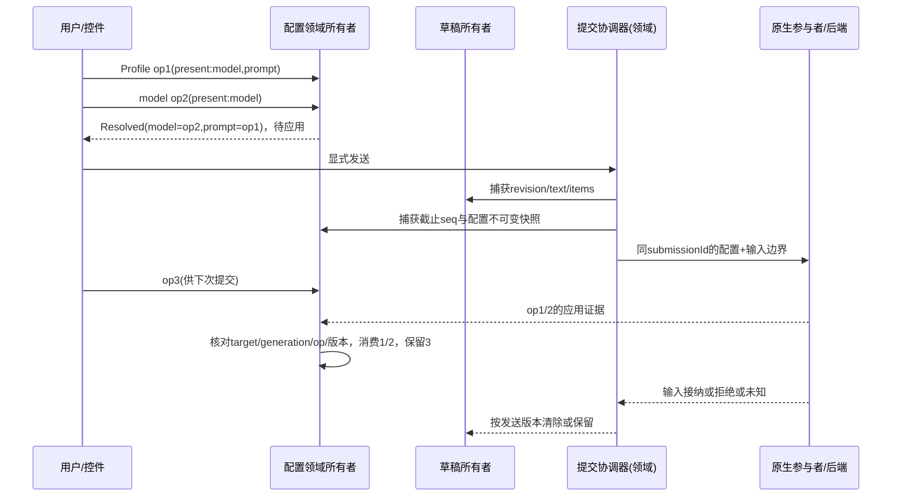

# V1：开放式前端环境模型

2026-10-03。独立前端设计快照，不代表生产API或后端024裁决。依据 inventory I01–I22。只读模型攻击，生产操作禁止。本版冻结，不以编辑覆盖攻击历史。

## 1 对象、权威与不变量

插件 = 可装入的能力提供者，拥有activation generation和ResourceScope；不等于页面、原生进程或无限权限。界面贡献 = 可撤销的页面/侧栏/菜单/设置/输入入口/组件提供记录。领域所有者 = 对某种事实唯一写入、解释业务操作的服务实例。运行实例 = 被实际参与者确认的owner/session/generation，生命周期不跟React组件。

平台提供插件生命周期、贡献、领域接入句柄、操作关联、连接、交互承载及能力代理；插件提供业务事实与操作语义。Workbench唯一管理布局/焦点/弹层/设置展示。配置领域所有者由Agent配置插件提供，Profile/model只是可选操作来源；Chat缺席仍可在配置页使用同一所有者。基础环境不依赖Agent、Chat、Profile、品牌Harness。

- N1：一个事实类型+目标+代际只有一个写者；控制器/转换器不得写它的镜像。
- N2：已确认、操作、待应用、草稿、历史分别标记；unknown不是空/null。
- N3：用户操作由同一所有者分配单调序号；同值重选也有新opId。
- N4：同一提交绑定冻结的文本/附件/配置版本，不能读取live控件补参数。
- N5：乱序或旧代际事件不覆盖新事实，也不吞掉较新操作；unknown不自动重发。
- N6：关闭视图只撤销视图订阅；插件移除撤销贡献及句柄，不等于成功停止原生运行。
- N7：未知原生能力在已授权承载通道转发，平台不维护品牌命令全集；内容不能升级为审批/系统权限。
- N8：数据和事件更新不重新挂载输入，不改变焦点、IME、草稿和光标；缓存可重建。

## 2 领域接入公共面（候选伪类型）

```ts
DomainRef = {domainId, contractMajor, ownerInstanceId, generation, target}
Target = {realm, connectionId, serverInstanceId, localWorkspaceId,
          logicalSessionId, nativeSessionId?, nativeGeneration?}
ObservableDomain<S,C> = {
  getSnapshot(): {ref: DomainRef, revision, evidence, value:S},
  subscribe(selector, listener): Disposable,
  dispatch(command:C, envelope:{opId, target, expectedGeneration, source}): Result,
  reconcile(opId): Result // 无副作用，缺能力显式unavailable
}
```

DomainAccess按插件scope借用owner服务，不复制领域对象。required缺席拒绝激活相关能力；optional返回absent描述。平台只校验身份/代际/关联，不定义配置字段、Agent运行枚举或后端账。owner注册在运行生命周期，视图引用计数不决定业务生命周期。操作路由捕获target，不以“当前选中”重路由；同target多窗口由共享owner序列化，本地窗口序号不能宣称全局顺序。Desktop可在专属领域worker或插件服务进程托管共享owner；普通网页无此能力时只开放单窗口，明确限制，不虚构跨窗口一致性。

平台的结果关联记录只持opId、source、target、phase和领域结果引用，领域所有者持具体配置/运行事实。传输adapter可持requestId映射、socket phase、frame缓冲，不持pending model/profile或已应用配置。

## 3 配置所有者

唯一 AgentConfigurationOwner，每逻辑目标一个实例记录；不存在ProfileOwner配置和ModelOwner配置两份实际状态。它持有：

- Confirmed：原生/后端证据确认的字段、owner身份、nativeRevision、证据种类和来源。字段unknown、known(value)、known-unset分开。传输断线标stale，保留lastObserved，不宣称current。
- Operations：用户已表达但尚未消费的patch操作。opId、全局seq、source、目标、字段present集合、值/显式unset、catalogRevision、phase。Profile选择立即捕获实际包含的字段，model操作只捕获model原子字段组（模型+provider引用+版本），缺model不写model。插件不得看Profile字符串自行推断模型。
- Resolved：纯函数 fold(Confirmed基底, 按seq的待应用Operations)。字段缺失保留，显式unset必须契约允许。全空Profile也是有效操作；provider或Profile版本变更不静默改已捕获patch。
- Applications：冻结submissionId、截止seq、baseRevision、resolvedRevision/digest、target和应用/发送结果引用。它是本地关联视图，不是前端执行账。

Profile目录插件负责解析清单内容和版本。Owner通过公共resolveSelection取得patch并验证；不透明/不可本地解析Profile保留resolving，相关提交不能装作配置已知。model目录负责可用项/资格证据，不负责当前模型。解析可异步：seq在点击时分配，晚返回保持序号；未解析操作有确定字段集合或保守阻塞提交，不能因返回顺序改变覆盖顺序。

原生自主变更更新Confirmed；仍pending的本地操作按seq覆盖其声明字段，作为下一次待应用；无pending字段跟随新事实。已消费操作不会永久作为overlay盖住新事实。模型主标签取Resolved.model，旁边/详情给confirmed及pending/stale/unknown证据状态，不能把选择label当实际配置。Profile显示“最近应用操作来源”，不暗示全部字段仍等于Profile。

## 4 提交边界与核对



发送协调器属于Agent交互领域，与Chat组件解耦；它捕获草稿revision与配置快照，配置应用确认与输入接纳是两个结果。应用成功+输入拒绝仍保留草稿，配置confirmed可更新；应用未知则不继续输入。底层支持原子边界/应用凭证时校验digest+generation；只有apply再prompt但没有关联保证时，不能标“一致发送已验证”，配置变更相关提交返回unsupported。无配置操作的普通原生文本能力可单独使用，不伪称同样保证。

回执必须匹配target、generation、opId、捕获digest/nativeRevision。更新事实按nativeRevision，不能按接收时间。旧应用回执可完成旧Application，但不能回退最新Confirmed；消费仅捕获的opIds，不按“seq以下全部”盲清。回执未带可比较版本则作为证据留档并请求观察，不能决定覆盖。重复回执幂等。确认与新的原生观察矛盾则unknown/conflict，不任选一个。视图切换只影响展示，回执仍回到原target所有者，返回后可看到结果。

unknown不是retryable refusal。主动reconcile不apply、不create、不prompt。缺reconcile时保持未知关联、允许独立只读操作，不自动重发；新提交不得跨未知配置结果。明确拒绝后新尝试用新submissionId；再次发送仍是显式用户动作。草稿成功仅当当前revision等于捕获revision才清空，文本相等不能覆盖ABA编辑。结果未知、明确拒绝均保留草稿和错误关联。

## 5 草稿与恢复

草稿由DraftOwner按(windowId,composerId,logicalSessionId/draftId)拥有文本/附件revision；不是组件内部生命周期。新draftId全局唯一。选模型/Profile只创建本地操作，不创建native session。首次发送协调器用creationAttemptId一次创建/应用/关联；未知保留身份，不能另建。draft→native绑定由会话领域所有者原子迁移逻辑目标映射，配置操作和草稿身份不丢；不用复制两个store再互相同步。

持久化：UI布局由Workbench，插件启用清单由装配配置，领域历史/已确认事实仍以原持久层为权威。前端重启只恢复lastObserved证据与未发送草稿；待应用操作作为恢复建议，不自动apply；应用/发送unknown关联必须先核对。旧native generation只显示历史，不借旧Token执行。敏感字段仅引用；本轮不修改SQLite/部署格式/extension ids。

## 6 生命周期、开放交互与安全

沿用Lumino registry与ResourceScope。激活staging→验证依赖/贡献→active；停用active→draining，拒新命令，撤销贡献/菜单/订阅/弹层/能力句柄；结果记录不随视图销毁。pending操作变unavailable但不宣称取消成功；运行由领域策略继续观察或显式拒绝卸载其必需owner，不能因卸载kill服务。旧回调带owner generation和scope lease，每个入口执行时再核验；重新启用新generation，旧Token对象不能证明授权。UI provider generation与native generation独立，契约Token唯一构造且跨包external、共享import map；版本不兼容拒绝。

InteractionSurface是承载描述（input/command/stream/terminal/embedded-view及可扩展kind），provider实现输入/事件schema与能力协商。平台路由(scope, owner, surfaceId, instanceId, generation)，无Harness品牌分支。raw native入口不经过环境command registry；/workflow即使目录未列出，只要native text/command通道已授权就原样传递。环境命令通过命令面板/显式环境入口；native输入同名也发native，展示来源区分；缺通道明确unavailable，不转为环境错误。未知event作为有来源的有界原文/附件预览，不解释审批状态。

第三方默认隔离。现有同renderer JS为用户明确受信安装模式，不能作为恶意插件安全边界。隔离provider在独立受限进程/内容frame，只有schema消息桥；不能拿window.desktopHost、agentNative、宿主DOM、Token实例或任意路径。main授予绑定plugin/activation/frame/target的能力lease，校验来源+lease+schema+方法/资源策略，撤销实时生效；客户端声称pluginId无资格授权。当前CSP frame-src none，不放宽整个主页面来假装隔离。native open参数是配置允许的adapterId，非用户HTML路径；通用send只限定能力/体积，不枚举原生命令名。

工具输出/网页/Markdown均不可信数据。禁止原始HTML脚本、事件属性、javascript链接，明确外链动作；approval只能来自可信领域交互证据与宿主受控组件，输出不能生成可审批令牌。原生终端只是受授予资源限制的交互承载，是否允许spawn/shell属于单独能力策略，嵌入视图不自动获得它。普通网页默认无native，功能显式降级。

## 7 输入、弹层和资源界限

输入节点key只由逻辑composer身份决定，不依赖stateRevision/消息计数/模型值。IME组合期间Enter、面板选择、远程草稿修改都不能触发提交或替换正在组合文本；结束时合并本地revision。一个DraftOwner可给多个视图只读展示，编辑入口用独立composer草稿，避免窗口互改输入。

Workbench唯一overlay stack；portal承载脱离overflow，focus stack及Esc只处理top，关/卸载回到仍有效触发器，否则回主内容；系统窗口chrome独立保留。组件异常只切断该视图，不重启owner。

流provider声明可恢复cursor/backpressure；UI批量刷新、长列表虚拟化，缓冲按条数+字节双界限，不能无界储存原始事件。候选默认：每流1MiB/1000条待消费，单帧256KiB，历史视窗500行，30Hz绘制；超过预算暂停/断开该表面并显示gap，关键状态不得静默丢弃，必须重新取权威快照。无可恢复能力标incomplete；日志脱敏、错误有id并有有界保留，不通过每次render刷新错误时间。此数值是待性能验证参数。

## 8 合法/非法序列

|前提/序列|合法结果|非法反例|
|---|---|---|
|Profile A(model M1,prompt P1)→model B|Resolved B/P1；confirmed仍旧至回执|两个控件各显示自己的最近选择|
|model B→Profile A(model M1)|Resolved M1；重叠字段后操作胜|迟到model登记让B覆盖A|
|model B→Profile A(no model)|Resolved B+Profile其余项|缺字段转null清模型|
|同Profile重选→send|新opId重新patch，消费新操作|值相等跳过操作|
|发送冻结1/2→用户op3→迟到回执1/2|只消费1/2，op3仍pending|delete全部pending|
|会话S1请求→切S2→S1返回|更新S1 owner记录，S2输入不动|以selected target处理结果|
|未知create/send→重连|只核对原attempt；无证据继续unknown|新建session并自动重发|
|卸载generation1→启用generation2→旧回调|拒绝stale，可保留旧结果记录|Token名字相同就调用新实例|

## 9 三个完整接入例子

**原生Agent交互插件**：声明Agent契约和Connections required、Chat optional；注册AgentSessionOwner、AgentConfigurationOwner和原生InteractionSurface provider。原生socket adapter只校验形状/传输映射，将证据送owner。贡献会话页/侧栏/设置/命令和可选Chat输入；控件借用同owner，模型/Profile可缺席。发送由领域协调器完成。停用撤销UI与新的输入授权，尚未确认运行不假终止；owner为运行所需时延期移除或显式拒绝卸载，仍可关UI。

**资源管理插件**：ResourceOwner拥有目录/文件版本与操作结果，settings值由其拥有；Workbench页面/侧栏/菜单/设置贡献只project和dispatch。Chat optional集成注册add-content入口，返回服务发出的opaque reference，不发送文件系统路径/预览URL代替真实引用。选择文件准备有opId，卸载前未handoff引用由owner安全回收或标cleanup unknown；已发送引用不由UI销毁。无Chat仍完整管理资源；无资源provider显示缺席，不空列表假成功。无宿主内部导入。

**非聊天终端/独立视图插件**：TerminalOwner负责会话身份/终端缓冲cursor/退出证据；provider声明terminal交互，贡献页面/状态/设置/打开入口。native adapter由允许的能力lease开连接，输入保序、流有界，resize合并不等于丢输入；未授予shell时只读终端/远程工具承载。无Chat/Agent/Profile也可装入。卸载关闭视图和输入lease不冒充已停止进程，断流有gap；远程网页默认隔离，仅受schema限制的消息进入owner。

## 10 证据和未决接口

本版为设计，不含实机测试；源码依据见inventory，离线检查待建立。后端需要身份/版本/原子配置发送/核对/创建关联/原生观察等能力，列backend-interface-questions.md；缺席时拒绝依赖该保证的路径，不冻结024。具体状态库与包数在模型攻击后决定。D1/D2由用户授权主会话先选合适设计，尚未批准生产授权或数据迁移。
