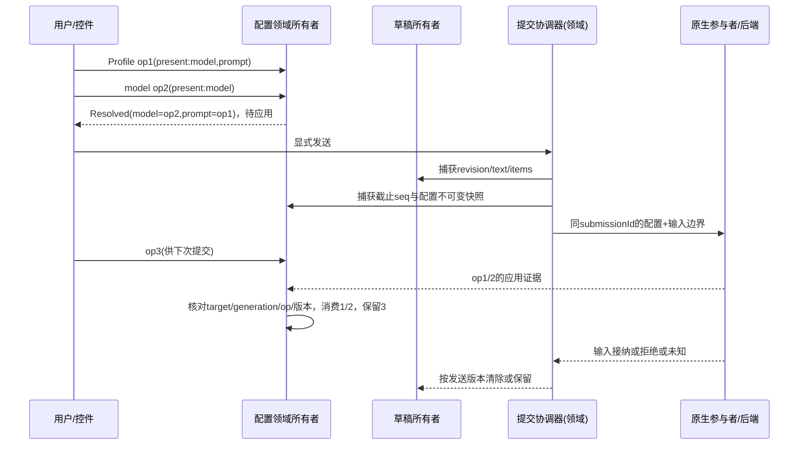

# V4：开放式前端环境模型

2026-10-03。独立前端设计快照，不代表生产API或后端024裁决。依据 inventory I01–I22。只读模型攻击，生产操作禁止。本版为复查后最终候选；规则优先级§14 > §12 > §11 > 基础正文。V1/V2及攻击历史冻结保留。

## 1 对象、权威与不变量

插件 = 可装入的能力提供者，拥有activation generation和ResourceScope；不等于页面、原生进程或无限权限。界面贡献 = 可撤销的页面/侧栏/菜单/设置/输入入口/组件提供记录。领域所有者 = 对某种事实唯一写入、解释业务操作的服务实例。运行实例 = 被实际参与者确认的owner/session/generation，生命周期不跟React组件。

平台提供插件生命周期、贡献、领域接入句柄、操作关联、连接、交互承载及能力代理；插件提供业务事实与操作语义。Workbench唯一管理布局/焦点/弹层/设置展示。配置领域所有者由Agent配置插件提供，Profile/model只是可选操作来源；Chat缺席仍可在配置页使用同一所有者。基础环境不依赖Agent、Chat、Profile、品牌Harness。

- N1：一个事实类型+目标+代际只有一个写者；控制器/转换器不得写它的镜像。
- N2：已确认、操作、待应用、草稿、历史分别标记；unknown不是空/null。
- N3：用户操作由同一所有者分配单调序号；同值重选也有新opId。
- N4：同一提交绑定冻结的文本/附件/配置版本，不能读取live控件补参数。
- N5：乱序或旧代际事件不覆盖新事实，也不吞掉较新操作；unknown不自动重发。
- N6：关闭视图只撤销视图订阅；插件移除撤销贡献及句柄，不等于成功停止原生运行。
- N7：未知原生能力在已授权承载通道转发，平台不维护品牌命令全集；内容不能升级为审批/系统权限。
- N8：数据和事件更新不重新挂载输入，不改变焦点、IME、草稿和光标；缓存可重建。

## 2 领域接入公共面（候选伪类型）

```ts
DomainRef = {domainId, contractMajor, ownerInstanceId, generation, target}
Target = {realm, connectionId, serverInstanceId, localWorkspaceId,
          logicalSessionId, nativeSessionId?, nativeGeneration?}
ObservableDomain<S,C> = {
  getSnapshot(): {ref: DomainRef, revision, evidence, value:S},
  subscribe(selector, listener): Disposable,
  dispatch(command:C, envelope:{opId, target, expectedGeneration, source}): Result,
  reconcile(opId): Result // 无副作用，缺能力显式unavailable
}
```

DomainAccess按插件scope借用owner服务，不复制领域对象。required缺席拒绝激活相关能力；optional返回absent描述。平台只校验身份/代际/关联，不定义配置字段、Agent运行枚举或后端账。owner注册在运行生命周期，视图引用计数不决定业务生命周期。操作路由捕获target，不以“当前选中”重路由；同target多窗口由共享owner序列化，本地窗口序号不能宣称全局顺序。Desktop可在专属领域worker或插件服务进程托管共享owner；普通网页无此能力时只开放单窗口，明确限制，不虚构跨窗口一致性。

平台的结果关联记录只持opId、source、target、phase和领域结果引用，领域所有者持具体配置/运行事实。传输adapter可持requestId映射、socket phase、frame缓冲，不持pending model/profile或已应用配置。

## 3 配置所有者

唯一 AgentConfigurationOwner，每逻辑目标一个实例记录；不存在ProfileOwner配置和ModelOwner配置两份实际状态。它持有：

- Confirmed：原生/后端证据确认的字段、owner身份、nativeRevision、证据种类和来源。字段unknown、known(value)、known-unset分开。传输断线标stale，保留lastObserved，不宣称current。
- Operations：用户已表达但尚未消费的patch操作。opId、全局seq、source、目标、字段present集合、值/显式unset、catalogRevision、phase。Profile选择立即捕获实际包含的字段，model操作只捕获model原子字段组（模型+provider引用+版本），缺model不写model。插件不得看Profile字符串自行推断模型。
- Resolved：纯函数 fold(Confirmed基底, 按seq的待应用Operations)。字段缺失保留，显式unset必须契约允许。全空Profile也是有效操作；provider或Profile版本变更不静默改已捕获patch。
- Applications：冻结submissionId、截止seq、baseRevision、resolvedRevision/digest、target和应用/发送结果引用。它是本地关联视图，不是前端执行账。

Profile目录插件负责解析清单内容和版本。Owner通过公共resolveSelection取得patch并验证；不透明/不可本地解析Profile保留resolving，相关提交不能装作配置已知。model目录负责可用项/资格证据，不负责当前模型。解析可异步：seq在点击时分配，晚返回保持序号；未解析操作有确定字段集合或保守阻塞提交，不能因返回顺序改变覆盖顺序。

原生自主变更更新Confirmed；仍pending的本地操作按seq覆盖其声明字段，作为下一次待应用；无pending字段跟随新事实。已消费操作不会永久作为overlay盖住新事实。模型主标签取Resolved.model，旁边/详情给confirmed及pending/stale/unknown证据状态，不能把选择label当实际配置。Profile显示“最近应用操作来源”，不暗示全部字段仍等于Profile。

## 4 提交边界与核对



发送协调器属于Agent交互领域，与Chat组件解耦；它捕获草稿revision与配置快照，配置应用确认与输入接纳是两个结果。应用成功+输入拒绝仍保留草稿，配置confirmed可更新；应用未知则不继续输入。底层支持原子边界/应用凭证时校验digest+generation；只有apply再prompt但没有关联保证时，不能标“一致发送已验证”，配置变更相关提交返回unsupported。无配置操作的普通原生文本能力可单独使用，不伪称同样保证。

回执必须匹配target、generation、opId、捕获digest/nativeRevision。更新事实按nativeRevision，不能按接收时间。旧应用回执可完成旧Application，但不能回退最新Confirmed；消费仅捕获的opIds，不按“seq以下全部”盲清。回执未带可比较版本则作为证据留档并请求观察，不能决定覆盖。重复回执幂等。确认与新的原生观察矛盾则unknown/conflict，不任选一个。视图切换只影响展示，回执仍回到原target所有者，返回后可看到结果。

unknown不是retryable refusal。主动reconcile不apply、不create、不prompt。缺reconcile时保持未知关联、允许独立只读操作，不自动重发；新提交不得跨未知配置结果。明确拒绝后新尝试用新submissionId；再次发送仍是显式用户动作。草稿成功仅当当前revision等于捕获revision才清空，文本相等不能覆盖ABA编辑。结果未知、明确拒绝均保留草稿和错误关联。

## 5 草稿与恢复

草稿由DraftOwner按(windowId,composerId,logicalSessionId/draftId)拥有文本/附件revision；不是组件内部生命周期。新draftId全局唯一。选模型/Profile只创建本地操作，不创建native session。首次发送协调器用creationAttemptId一次创建/应用/关联；未知保留身份，不能另建。draft→native绑定由会话领域所有者原子迁移逻辑目标映射，配置操作和草稿身份不丢；不用复制两个store再互相同步。

持久化：UI布局由Workbench，插件启用清单由装配配置，领域历史/已确认事实仍以原持久层为权威。前端重启只恢复lastObserved证据与未发送草稿；待应用操作作为恢复建议，不自动apply；应用/发送unknown关联必须先核对。旧native generation只显示历史，不借旧Token执行。敏感字段仅引用；本轮不修改SQLite/部署格式/extension ids。

## 6 生命周期、开放交互与安全

沿用Lumino registry与ResourceScope。激活staging→验证依赖/贡献→active；停用active→draining，拒新命令，撤销贡献/菜单/订阅/弹层/能力句柄；结果记录不随视图销毁。pending操作变unavailable但不宣称取消成功；运行由领域策略继续观察或显式拒绝卸载其必需owner，不能因卸载kill服务。旧回调带owner generation和scope lease，每个入口执行时再核验；重新启用新generation，旧Token对象不能证明授权。UI provider generation与native generation独立，契约Token唯一构造且跨包external、共享import map；版本不兼容拒绝。

InteractionSurface是承载描述（input/command/stream/terminal/embedded-view及可扩展kind），provider实现输入/事件schema与能力协商。平台路由(scope, owner, surfaceId, instanceId, generation)，无Harness品牌分支。raw native入口不经过环境command registry；/workflow即使目录未列出，只要native text/command通道已授权就原样传递。环境命令通过命令面板/显式环境入口；native输入同名也发native，展示来源区分；缺通道明确unavailable，不转为环境错误。未知event作为有来源的有界原文/附件预览，不解释审批状态。

第三方默认隔离。现有同renderer JS为用户明确受信安装模式，不能作为恶意插件安全边界。隔离provider在独立受限进程/内容frame，只有schema消息桥；不能拿window.desktopHost、agentNative、宿主DOM、Token实例或任意路径。main授予绑定plugin/activation/frame/target的能力lease，校验来源+lease+schema+方法/资源策略，撤销实时生效；客户端声称pluginId无资格授权。当前CSP frame-src none，不放宽整个主页面来假装隔离。native open参数是配置允许的adapterId，非用户HTML路径；通用send只限定能力/体积，不枚举原生命令名。

工具输出/网页/Markdown均不可信数据。禁止原始HTML脚本、事件属性、javascript链接，明确外链动作；approval只能来自可信领域交互证据与宿主受控组件，输出不能生成可审批令牌。原生终端只是受授予资源限制的交互承载，是否允许spawn/shell属于单独能力策略，嵌入视图不自动获得它。普通网页默认无native，功能显式降级。

## 7 输入、弹层和资源界限

输入节点key只由逻辑composer身份决定，不依赖stateRevision/消息计数/模型值。IME组合期间Enter、面板选择、远程草稿修改都不能触发提交或替换正在组合文本；结束时合并本地revision。一个DraftOwner可给多个视图只读展示，编辑入口用独立composer草稿，避免窗口互改输入。

Workbench唯一overlay stack；portal承载脱离overflow，focus stack及Esc只处理top，关/卸载回到仍有效触发器，否则回主内容；系统窗口chrome独立保留。组件异常只切断该视图，不重启owner。

流provider声明可恢复cursor/backpressure；UI批量刷新、长列表虚拟化，缓冲按条数+字节双界限，不能无界储存原始事件。候选默认：每流1MiB/1000条待消费，单帧256KiB，历史视窗500行，30Hz绘制；超过预算暂停/断开该表面并显示gap，关键状态不得静默丢弃，必须重新取权威快照。无可恢复能力标incomplete；日志脱敏、错误有id并有有界保留，不通过每次render刷新错误时间。此数值是待性能验证参数。

## 8 合法/非法序列

|前提/序列|合法结果|非法反例|
|---|---|---|
|Profile A(model M1,prompt P1)→model B|Resolved B/P1；confirmed仍旧至回执|两个控件各显示自己的最近选择|
|model B→Profile A(model M1)|Resolved M1；重叠字段后操作胜|迟到model登记让B覆盖A|
|model B→Profile A(no model)|Resolved B+Profile其余项|缺字段转null清模型|
|同Profile重选→send|新opId重新patch，消费新操作|值相等跳过操作|
|发送冻结1/2→用户op3→迟到回执1/2|只消费1/2，op3仍pending|delete全部pending|
|会话S1请求→切S2→S1返回|更新S1 owner记录，S2输入不动|以selected target处理结果|
|未知create/send→重连|只核对原attempt；无证据继续unknown|新建session并自动重发|
|卸载generation1→启用generation2→旧回调|拒绝stale，可保留旧结果记录|Token名字相同就调用新实例|

## 9 三个完整接入例子

**原生Agent交互插件**：声明Agent契约和Connections required、Chat optional；注册AgentSessionOwner、AgentConfigurationOwner和原生InteractionSurface provider。原生socket adapter只校验形状/传输映射，将证据送owner。贡献会话页/侧栏/设置/命令和可选Chat输入；控件借用同owner，模型/Profile可缺席。发送由领域协调器完成。停用撤销UI与新的输入授权，尚未确认运行不假终止；owner为运行所需时延期移除或显式拒绝卸载，仍可关UI。

**资源管理插件**：ResourceOwner拥有目录/文件版本与操作结果，settings值由其拥有；Workbench页面/侧栏/菜单/设置贡献只project和dispatch。Chat optional集成注册add-content入口，返回服务发出的opaque reference，不发送文件系统路径/预览URL代替真实引用。选择文件准备有opId，卸载前未handoff引用由owner安全回收或标cleanup unknown；已发送引用不由UI销毁。无Chat仍完整管理资源；无资源provider显示缺席，不空列表假成功。无宿主内部导入。

**非聊天终端/独立视图插件**：TerminalOwner负责会话身份/终端缓冲cursor/退出证据；provider声明terminal交互，贡献页面/状态/设置/打开入口。native adapter由允许的能力lease开连接，输入保序、流有界，resize合并不等于丢输入；未授予shell时只读终端/远程工具承载。无Chat/Agent/Profile也可装入。卸载关闭视图和输入lease不冒充已停止进程，断流有gap；远程网页默认隔离，仅受schema限制的消息进入owner。

## 10 证据和未决接口

本版为设计，不含实机测试；源码依据见inventory，离线检查待建立。后端需要身份/版本/原子配置发送/核对/创建关联/原生观察等能力，列backend-interface-questions.md；缺席时拒绝依赖该保证的路径，不冻结024。具体状态库与包数在模型攻击后决定。D1/D2由用户授权主会话先选合适设计，尚未批准生产授权或数据迁移。

## 11 第一轮修订：可实施规则（替代前文歧义）

### 11.1 操作、解析、领取与发送

LogicalKey=(realm,serverInstanceId,connectionId,logicalSessionId)，native绑定单独记录，不用model、Profile、window或owner实例号定义配置权威槽。同target所有窗口的dispatch、capture、申请领取都进入一个共享owner串行入口；每target最多一个inflight Application，第二发送返回busy保留草稿，用户下一次显式提交才重捕获，不自动排队prompt。跨目标独立。

Operation phase为resolving/ready/refused/reserved/unknown/consumed/cancelled；resolved patch只在操作自己的phase转移中登记。点击时固定selectionRef/catalogRevision/contentDigest，seq立即分配；resolver必须返回相同revision/digest与field mask，否则refused，显式重选才新操作。resolving/refused阻相关提交；用户可显式取消该操作（未reserved），不自动选择旧配置。

capture同时冻结配置视图及writePatch（仅操作声明字段的顺序fold），保留操作所有id和resolvedRevision。原生应用必须校验baseRevision或等价一致性凭证，保证输入使用冻结有效配置且不把基底字段当patch写回。并发native更改导致条件拒绝：本次不发prompt，保持操作/草稿，刷新事实，下一次用户发送重新捕获，不自动“偷偷rebase发送”。契约缺席明确unsupported。有效快照摘要按规范字段类型/known-unset/unknown/mask/版本确定，未知字段不能作为已知默认序列化；秘密只送引用。

ready→reserved(submissionId)在outbound前，只有此提交可消费。明确无应用的拒绝释放回ready（仍保留seq）；未知不释放；应用已确认消费精确id，输入拒绝不复活该配置操作。同值op是不同身份，不能按patch相等合并。

### 11.2 证据与部分应用

两种证据独立：E-execution证明某Application捕获的opIds/digest在某native generation被整体执行；E-current证明当前字段在可比nativeRevision的值。消费需完整E-execution（可信来源、target/binding、generation、submissionId/应用id、digest/opIds）；普通值相同观察不够。E-execution无可比revision仍可消费，但Confirmed只按独立E-current更新；若缺当前有效证据，Resolved基底和依赖完整配置的发送保持unknown/stale，不能用请求值当读回。没有E-execution则Application unknown，阻相关新提交。

旧执行回执r11与更新观察r12值不同合法：消费旧捕获操作、Confirmed保留r12；仅同可比revision不同内容、同execution关联互相矛盾或版本身份链无法核对才conflict。native版本不靠本地clock推断。

本提案选择“配置patch整体原子应用”作为保证路径的required能力；不设计字段级自动补偿。缺整体保证时拒绝这一配置提交；若对方违反承诺返回部分应用，已证字段记录为观察，Application partial-unknown，输入不发送，不整体消费、不自动重试、不回滚已应用字段。显示部分应用及所缺证据，后续仅核对；需字段补救由用户显式新操作且经领域契约支持，不能偷偷恢复旧Profile。该部分故障不是正常可重试拒绝。

### 11.3 首次绑定、崩溃与恢复

稳定LogicalKey不随draft→native变。Binding=(nativeSessionId,nativeGeneration,bindingRevision,creationAttemptId,proof)。首次提交冻结logical key和unbound bindingRevision；同logical key一次创建领取，全窗口共享。合法T0→T1只由相同creationAttemptId的可信绑定证据更新一次；新操作仍在同logical key记录，旧提交只消费捕获集合。其他attempt/native identity冲突unknown，不猜哪个是正确会话。解绑/替换native产生新bindingRevision，旧结果只能进入旧Application，不能更新新native事实。

最小本地关联标记 `{submissionId,LogicalKey,bindingRef/creationAttemptId,payloadDigest,opIds,draftRevision,possiblySubmitted}` 必须在outbound前可靠写入；不持凭据或复制后端执行细节。写失败禁止发送需要恢复保证的路径。重启恢复possiblySubmitted→unknown只读核对，不能作未提交。草稿和恢复标记关联写入，垃圾回收仅在明确终结且草稿handoff/资源结清后。旧unknown无核对端口仍保留，明确人工处置限制；不靠超时解锁。

### 11.4 生命周期与收尾

现有runtime先close scope再deactivate不能实现可拒卸载，迁移必须新增preflight机制，禁止把现状当已有保证。状态：requestDisable→preflight→rejected（仍active，所有scope完整）或draining→revoked→stopped。preflight检查required反向依赖闭包、inflight/unknown操作、运行与资源收尾；默认有存续业务则拒完整卸载，允许停UI。级联停用只能显式请求完整闭包，不能悄悄重启依赖者。进入draining之后失败是drain-failed，不能再宣称“拒绝且原样”。

插件有UI/交互scope和settlement scope；后者仍属于旧领域owner及旧activation，runtime保留受限只读/收尾lease直到全部已承诺操作结清。旧回执只追加旧结果和安全释放引用，不能恢复UI/发新业务命令/调用g2。没有合法存续owner或清理端口就拒完整移除；未知收尾只持关联引用和真实phase，不以超时伪成功。普通视图关闭不销毁owner。

激活批次register先staging不可见，成功后原子publish UI/owners/surfaces；staging无业务命令资格。允许的能力协商只读，资源获取仍需安全收尾；失败晚到open必须关闭并记录真实close结果。loader/host仍唯一调度，Workbench贡献batch是运行时子事务，不另排插件依赖。

可选集成采用独立子插件：资源基础required Workbench+Resource契约，resource-chat集成required Chat+Resource；Chat出现显式激活集成，移除则先停集成（依赖闭包），基础资源owner继续。不发明动态重绑同一基础激活。Profile/model-Chat同理。

### 11.5 完整候选公共API

以下是新增候选接口，Workbench/UI/Connections现有接口保留语义；代码迁移尚未实施。

```ts
RuntimeContext = {identity: {pluginId, activation}, uiScope, settlementScope,
  stageBatch(): ContributionBatch, domains: DomainAccess, surfaces: SurfaceRegistry,
  capabilities: CapabilityBrokerClient}
AuthorityKey = {domainId, major, LogicalKey}
ContributionBatch = {registerOwner(key, service): OwnerRegistration,
  contribute(kind, descriptor): Registration, registerSurface(descriptor, provider): Registration,
  commit(): Accepted|Refused, rollback(): SettlementResult}
DomainAccess = {acquire(key, callerScope): Ready<RevocableDomainRef>|Absent|Incompatible|Stale}
SurfaceRegistry = {bind({surfaceId,instanceId,target,generation}, scope):
  Ready<{send(envelope,payload),subscribe(cursor),close()}>|Unavailable}
CapabilityBrokerClient = {request(descriptor,scope): Granted<OpaqueLease>|Denied|Unavailable}
Result = Accepted{opId,resultRef}|Refused{opId,reason}|Unknown{opId,resultRef}|Unavailable|Stale
```

authority槽唯一性键不含ownerInstanceId；首注册批次通过原子compare-and-register取得唯一权威；同槽竞争导致后批次拒绝而不部分发布。确定provider由显式产品绑定，不能由页面自己选；变更provider走preflight旧槽结清和新activation，旧ref不可复用。不同native目标是不同LogicalKey，可共存。

Agent实例：stage owner/session/config/interaction provider→借用Connections→注册page/sidebar/settings/menu→commit→可选agent-chat集成借同domain→dispatch/捕获/结果→停集成和UI→preflight检查owner，结清后撤owner。Resource：注册ResourceOwner及页面/设置/菜单→commit；resource-chat单独激活准备reference→handoff；移除集成撤输入但收尾引用归旧ResourceOwner，基础不重建。Terminal：注册TerminalOwner+surface/独立页/settings/input→申请受限native lease→commit→发送/流→draining停止新输入、结清open/close→撤owner；无native lease仍可只读页面，执行入口unavailable。所有调用从公共context进入，不导入app/其他插件内部。声明schema/major错误、无provider、授权拒绝都有可见失败。

Token只在同一受信realm用共享runtime模块单构造；隔离插件使用domainId/major/schema握手，由broker从真实执行域绑定activation和lease，不传Token对象，不靠自报字符串授权。

### 11.6 隔离、native代码与授权承诺点

第三方renderer和第三方native模块均默认隔离；main仅加载宿主受信代理，第三方native entry不得import进main。缺受限执行域机制时拒绝第三方native加载。明确受信模式分别声明renderer权限和native/main代码权限，批准renderer不自动批准native；现有installed插件不得静默转换为已获隔离认证。此为后续安全设计，非本轮授予权限。

能力代理每个队列任务有授权commit point：所有await准备完成后，在副作用调用前原子核验lease/activation/target+占预算；撤销先于commit则refused且零副作用；commit先于撤销则该请求may-have-executed，进入旧settlement，不称取消。异步open后不能发布新句柄，要再次核验，失效则关闭旧连接并记录unknown/failed cleanup。副作用进程回调不能迁移新activation；取消信号是请求不是完成证据。

第三方绘制固定在带不可覆盖宿主来源chrome的区域；真实审批在宿主保留区且只消费可信interaction reference。内容点击最多来源标记的普通动作，不得创建审批/lease授权；隔离frame不能覆盖宿主区域/修改来源。外链允许http/https规范URL且用户明确点击，经main代理策略，不允许javascript/data/file/自定义scheme逃逸、重定向不得继承native能力。受信renderer模式不保证恶意视觉伪装隔离。

### 11.7 编辑与焦点规则

组合保护必须先于面板/快捷键副作用。输入维护本地EditBuffer（value,selection,composition,inputEpoch,editRevision），DraftOwner是文本权威，缓冲是尚未发布的组合草稿，普通输入只从该缓冲发布。无关领域通知selector相等则不触发value写回；IME中异步草稿/外部结果只能标pending，不写DOM value。组合结束按本地baseRevision发布；若外部有冲突，保留本地草稿标conflict，不覆盖、不自动发送。

组合end/取消后的尾Enter进入抑制屏障，结束组合的同一物理按键周期只能确认候选；下一个独立keydown/up周期才可提交。无可靠键周期的虚拟键盘提供显式发送按钮；实现阶段必须真实平台验证，不能以定时N毫秒猜测。弹层强制撤销先保存已知缓冲、composition cancelled，不假已提交未发布候选；切换inputEpoch使旧事件不触发新焦点。已知缓冲不含系统未发布的候选字，明确属于平台限制。

唯一Esc dispatcher在事件开始捕获top instanceId并消费事件，最多关闭一次；focus restore校验overlayStack revision/inputEpoch和触发器scope，无效回主内容。所有global overlay归Workbench，host chrome入口调用它。

设置表单每formId独立DraftOwner；save带baseRevision与field mask，领域条件冲突返回refused保留草稿，不自动盖新值；取消只丢本表单。外部通知更新事实与差异提示，不替换dirty草稿；A晚save成功只清A提交的相同revision。

### 11.8 每跳有界与恢复

producer→native executor→main broker→IPC→domain owner→view每跳独立限额/credit。UTF-8编码字节，解码前限长；最大深度32、数组条数/字段长度/解析时间界限由schema声明，解析放可终止worker，不在renderer无限stringify复杂对象。候选整宿主原始待消费16MiB、每plugin4MiB、每target2MiB、每surface1MiB；active流数量每plugin16全局64，创建速率每plugin8/s；单帧256KiB；可选值只可收紧权限，放宽预算需性能验收。

暂停view不等于暂停producer；无背压或超限则关闭该surface入站并丢弃其剩余transport队列，domain标gap/stale（相关执行结果unknown），不能继续报current。恢复以新streamEpoch取得snapshot+cursor，从cursor后续事件接续，旧epoch事件全部拒绝；没有快照/cursor则incomplete只读，不伪补历史。错误/关联记录也按状态分类有界：未决记录不能丢，达到限额拒新操作；已终结分页持久化，renderer只留视窗。终端输入不可丢，队列满拒绝并保留未发送输入；resize可合并，输出只能带gap截断。

## 12 第二轮修订：最终候选规范

本章替代前文通用Target/AuthorityKey/major/身份、生命周期、编辑和安全相关歧义；不要求插件同时遵守冲突的旧伪类型。实现时公开API按本章归一，V1/2只作版本历史。

### 12.1 通用领域目标与唯一权威

```ts
TargetRef = {realm, targetSchemaId, targetSchemaVersion, canonicalId}
AuthorityKey = {factDomainId, TargetRef} // 无contract major/owner instance
OwnerRef = {authorityKey, ownerInstanceId, ownerActivation, ownerGeneration,
            offeredContractVersions}
AgentLogicalKey = {realm, serverInstanceId, stableConnectionConfigId, logicalSessionId}
SurfaceRef = {providerActivation, registrationId, authorityRef,
              surfaceKind, instanceId, instanceGeneration}
```

平台提供target schema登记及规范化/身份校验，不把AgentKey设为所有业务必需目标。schema由领域契约拥有且有唯一明确解释；ResourceTarget使用workspace/resource稳定id，TerminalTarget使用本地/远程工具会话id，LocalDocumentTarget使用文档稳定id，都可无Agent/server/Connections。canonicalId为经schema验证的编码，不能任意拼字符串自报授权；平台另校验实际realm/provider授权。领域页面和设置借同authority。

唯一写者槽为factDomainId+规范target，major只在acquire协商。兼容多个major由同owner只读/操作adapter导出；不兼容消费者拒绝，不注册第二写者。替换provider不能因major/名字不同绕preflight。ownerGeneration仅描述该唯一槽的活实例，不加入唯一键。

Agent stableConnectionConfigId是连接配置/身份，socket instance、linkGeneration不入AgentKey。重连通过会话owner核对相同server/native binding并重新附着旧authority，unknown锁不丢。alias registry对(native authority namespace,owner identity,nativeSessionId,nativeGeneration)最多映射一逻辑authority；第二连接无法证明旧映射/权限时只读unverified，不能开新可写槽绕未知。明确不同realm/用户/原生owner实例可不同事实，但仅凭新socket id不够。server重启需按新server实例隔离，旧unknown仍可作为历史核对，不自动映射到新实例。

### 12.2 当前证据、字段链与绑定适用性

保证发送路径要求完整、可信E-current快照及可验证基底版本。完整快照的缺失字段须按schema显式unknown/known-unset，不能沿用旧值冒充新版本。原生patch事件须含prevRevision→revision的完整链；连续链才可从已有完整快照推导新完整快照。缺prev/链断/乱序先到r12时缓存有界并标整个相关基底stale，请求完整snapshot；不把未更新model标r12 current。迟到r11接上r10→11→12后可推导B/P1。若协议支持可信字段版本但无全量原子观察，只可显示分字段lastObserved；不能把合并出的视图当一致发送基底。事件和快照同revision不一致进入conflict。

操作另有applicability={logicalTarget,bindingRevision?,nativeGeneration?,schemaRevision}。已绑定时捕获的Profile/model操作默认绑定当前binding，替换或native generation变化使尚未reserved操作stale，不自动重base成新授权；用户重选产生新opId并重新核资格/版本。未绑定draft操作允许一次creationAttempt绑定承接，目标realm/执行能力/schema校验成功才转ready/reserved；该许可不能用于后续替换native。已reserved操作永远归捕获binding。将来逻辑持续意图需明确独立契约，不以名称同值推断。stale/cancelled状态仍可见，取消/重选由显式操作，不恢复“重新应用”按钮。

首次创建没有既存nativeRevision：捕获草稿的creation configuration intent、明确schema基底及完整待应用字段；一致首次创建+配置+输入必须由声明的创建边界保证，新native完整E-current/执行证据关联creationAttempt及digest。缺创建一致性契约不拿空revision冒充CAS，首发送unsupported；仅选择不创建。Q08是能力问题，不给024定义实现。

### 12.3 所有发送入口、草稿身份与未派发失败

DraftId是持久稳定编辑对象id，windowId/composerId只是attachment，重新打开/重启可通过草稿目录显式恢复同draftId；不会因新React实例生成新数据身份。多个编辑器同时写同draftId需排他编辑lease或明确冲突编辑协议，默认同一draft单编辑attachment、其他只读；各窗口普通输入可用独立draftId，不互改草稿。未发送普通编辑只保证会话内保留，跨崩溃持久化可选并明确说明；需要可靠发送恢复的路径，捕获的草稿revision/内容或安全本地引用与最小关联标记必须可靠关联写入。无法持久化或策略禁止存内容，返回unsupported恢复保证路径，不暗示可恢复。标记只归本地提交关联，非后端执行账。

所有入口（Enter、按钮、菜单、第三方invoke）先获得 edit publication ticket=(draftId,editRevision,draftRevision,inputEpoch)。活跃composition/未发布缓冲/dirty conflict不能取得ticket，本次发送refused，不延迟自动发；完成组合后用户再次显式发送。无组合且revision匹配，ticket和冻结capture在同一领域协调步骤验证，跨await或inputEpoch变则refused保留文本；按按钮不是绕过IME许可。组合强撤保存已知buffer进同draftId，以草稿目录可恢复入口展示，未发布系统候选限制明确。

outbound前持久化/序列化/能力验证等确定零commit失败终态为not-dispatched：同一owner原子终结Application、清inflight、reserved退ready，保留草稿/seq；写possiblySubmitted失败不造成永久busy。若已经可靠写marker但未commit，not-dispatched也可靠写入，写该终态失败则保守unknown（恢复不可证明零副作用），不靠内存猜解除。may-have-executed不可用本规则释放。配置已整体应用但输入未派发时消费配置、保留输入，不将应用当零commit。

### 12.4 停用原子门与UI附着

preflight期间runtime关闭该activation admission fence：新dispatch/required借用/lease commit/batch publish暂refused draining-preflight，仍可读既有授权数据和结算已承诺操作；UI仍active可显示原因。依赖图revision和已commit集合在同一门冻结/核验；preflight允许转draining/revoked与授权commit/required借用共用原子串行门。拒绝则恢复admission且原scope仍有效；不只补一次非原子读取。当前所有未决都入闭包，staging新依赖publish不能绕过该门。preflight超时返回拒绝并保持原激活，不能无期限半冻结。

presentation独立子插件/附着activation：业务owner仍active且共享，停UI只撤presentation lease/scope；恢复创建新presentation activation借同owner，旧UI callback失效，不能复用disposed scope，也不重复registerOwner。完整business draining后的owner仅settlement角色，只能核对已commit关联/清理，不接受新业务；UI可读取经授权旧结果，但不能借它重新发送。重新业务激活须旧槽释放/明确身份核对，不由恢复UI触发。

### 12.5 完整surface身份与接入表

registerSurface返回broker可核验SurfaceRef，bind(ref, callerScope, requestedRights)只能消费这个注册ref，不能按input/instance字符串搜索猜provider。registrationId在provider activation内唯一，重复batch原子拒绝；不同provider名字相同可共存，必须由显式入口选择ref。ref包含authority、provider activation、instance generation及协商schema；未知kind显示通用来源/不可用，不偷偷创建owner。共享Agent事实的多个surface仍借同配置authority。

|完整插件|真实目标与必需依赖|激活/使用/移除调用顺序|
|---|---|---|
|原生Agent|AgentTarget schema、Session/Config契约；交互所需Connections/native能力；Chat/Profile/model可缺|stage owners→registerSurface→贡献page/sidebar/settings/menu→commit；presentation借同OwnerRef；send取得edit ticket和capture→授予surface能力→结果回领域；停presentation可恢复新UI activation；完整卸载preflight检查未决及required闭包|
|资源管理|ResourceTarget(workspace/resource)；Workbench/Resource契约；本地读取能力按需，Chat非基础依赖|register唯一ResourceOwner→page/sidebar/settings/menu→commit；form save带base/mask；独立resource-chat required Chat+Resource借同ref→prepare opaque reference→handoff；先撤集成再UI，引用由旧settlement结清，不能丢owner|
|非聊天终端/独立视图|TerminalTarget或LocalDocumentTarget；surface/workbench；执行能力按需；无Agent/Chat/Profile|stage owner+surfaceRef+page/settings/input→能力request（无执行权为只读）→commit；bind明确ref，输入credit满拒绝保留；输出有界；停presentation不假终止进程；完整移除需要运行退出/合法收尾证明，否则拒绝|

上述每个entry都通过RuntimeContext公开面；main装配只选provider，无品牌逻辑。菜单是Workbench贡献位置，输入是surface/input source，Chat不是通用输入必需层。普通网页无native仍能本地资源视图（只允许浏览器合法资源能力），native执行入口明确缺席。

### 12.6 读权限、文档代际、审批与资源

acquire不天然授予领域全部snapshot。broker依据真实调用realm/activation/documentEpoch和requestedRights生成限定DomainViewRef（target/字段/事件mask、read/subscribe/reconcile/dispatch分别授权）。过滤在owner/broker端完成，再序列化给插件，插件selector仅对已授权视图做局部选择。getSnapshot及每次listener实际投递复验lease/documentEpoch；撤销清队列、取消订阅，旧结果只进宿主旧关联，不送新文档。settlement lease只可核对指定opIds及清理所需安全引用，不做新的广泛查询；复制给插件的数据无法撤回，此限制明确。

frame container不能代表执行文档；broker生成document/executionEpoch并绑定实际来源与消息端口，navigation/reload/crash先撤旧epoch和端口；新文档重新握手，不继承权限。已commit旧操作结果仍归旧记录，不能披露给新文档；不相信payload的pluginId/origin/epoch。隔离内容导航默认禁；外链由明确用户动作经代理另开普通浏览器，不能保留native lease。

审批来源可信仍须claim：按interactionId/version/target/nativeGeneration/pending做条件单次领取，多个视图共享同一owner入口，重复/旧按钮stale。答复unknown锁住同interaction，只读核对原replyId，不自动再次approve/refuse；缺版本/条件答复/可核对身份仅只读，不开放可审批按钮。展示action不创建lease；授权界面属宿主策略入口，输出不能模拟其语义。Q10尚未稳定，不能把这当后端已实现。

资源能力授权对象为scoped opaque ResourceRef（允许root、实际资源身份、操作范围/lease），不是任意路径字符串。代理/受限executor安全打开且验证真实资源身份、symlink/路径替换/挂载变化，不把准备阶段字符串检查当最终授权。main只传受限句柄/引用；独立进程本身不代表OS隔离。安全open/OS资源限制机制缺席拒绝保证访问；批准任意shell是另一个明确高权能力，不从terminal/HTML入口推导。

### 12.7 预算覆盖所有保留形态

总预算覆盖raw buffer、解码工作集/索引、owner history cache、投影及view缓存，不能只算未消费字节。候选上限：raw总16MiB（§11.8局部限额仍适用）、decoded+派生可驻留总64MiB、单plugin16MiB、单target8MiB、单解析峰值8MiB；含估算对象开销和实际计量，超限明确拒绝/截流并gap，不承诺这些数值已达产品性能。owner历史页化/有界缓存，terminal保留scrollback有明确条数/字节上限，输出缓存无权当完整历史。共享不可变投影避免每view复制，无法精确计量时保守额度及可终止worker，不用raw大小推断内存安全。

credit仅在下一跳已接管其预算内存或释放数据时归还；IPC送达不代表domain可无预算保留。未知操作/恢复记录不得驱逐，为未决关联保留独立有界额度，额满拒新业务，已终结记录分页持久化。单次界限须在解码和可执行内容进入前生效；预算表是候选设计，最终需隔离压力测试和原生进程内存实测。

## 13 版本收束与可交审核含义

V1→第一轮25攻击→V2；V2→第二轮16攻击→V3。设计反例处理见round-1/2；独立复查见review。源码证据S、确定性模型L、设计文义D分开。真实IME、Electron隔离/IPC、OS资源限制、跨窗口owner、构建Token、backend一致边界均未验证；相关实施门在refactor-plan，缺能力不能宣称产品完成。此候选是可审核设计，并非批准代码迁移、数据格式变更或真实系统授权。

## 14 独立复查修订

### 14.1 schema编码版本不是事实身份（B3-01/F-01）

TargetRef是传输/验证表示，不能直接作为JS结构相等的authority槽键。公开注册流程先经可信schema registry normalize(TargetRef)→CanonicalFactTarget={realm,identityNamespace,stableEntityId}；AuthorityKey={factDomainId,CanonicalFactTarget}，不含targetSchemaId/version、contract major、provider instance、window/socket身份。编码schema在注册时声明跨兼容版本归一映射；v1/v2表示同workspace/resource时必须生成同stableEntityId，第二注册被拒。schemaId不同但物理事实相同也不能自行选择新namespace绕过唯一性，需要领域身份registry认可的唯一namespace/alias绑定。

缺可信等价映射时禁止新版本并行写旧namespace覆盖的实体，允许只读unverified或显式停旧provider、核对未决、整体迁移身份绑定后启新provider；不允许注册两份再同步。身份迁移若影响用户数据/已存在native alias，要另获实现授权及迁移兼容证据，本设计不批准。Agent alias是领域specific补充，通用资源/文档也需自己的稳定身份与alias检查；不靠路径显示字符串推断同一物理文件。选择平台规范化机制不表示前端能替backend发明真实实体身份。

### 14.2 参考模型冲突保护及范围（F-02）

最终规范早已要求同revision矛盾conflict阻依赖配置提交；独立复查发现参考脚本只返回字符串没有锁住capture。脚本修正为保留原Confirmed、stale/conflict阻capture，并加同revision错误内容拒绝及更新快照恢复正例。input-unknown即使配置confirmed仍保留Application锁，核对原输入结果后才放行；not-dispatched终态标记写失败保守unknown亦补离线序列。完整来源/绑定/深度/持久化/OS/DOM校验仍未实现，参考模型不是完整规范执行器。review与offline-results记录准确检查数量和限制。

本版复查补丁在V3快照之后，V3保持原样；最终交审核版本V4，不把复查暴露的错误隐藏在旧攻击记录中。

### 14.3 主验收修订 A-03/A-04（2026-10-03）

冲突状态与增量链缺口分别记录，不能只用一个可随普通观察清零的stale位。相同revision的任一重复观察（包括与保留Confirmed相同）不是核对裁决，不能解除已有conflict；patch补链也不能选择冲突的一边。有限参考模型只允许可信完整的新版本快照解除这一冲突；真实实现若支持同版本核对裁决，须另有可信来源/目标/覆盖范围的明确合同，不在这里假造。

接纳可信完整快照时清除已覆盖/失效的缓冲链段，保留快照版本之后尚有缺口的有效链段；再按prevRevision连续推进。旧增量不能回退事实或重新制造已解决缺口，未覆盖的未来缺口仍阻依赖提交。checks补上“冲突→重复原观察→仍拒绝→新完整快照恢复”和“缺口→完整快照→连续patch→可提交”，并检查未来未覆盖缺口仍拒绝。没有新增生产协议或实现保证。
