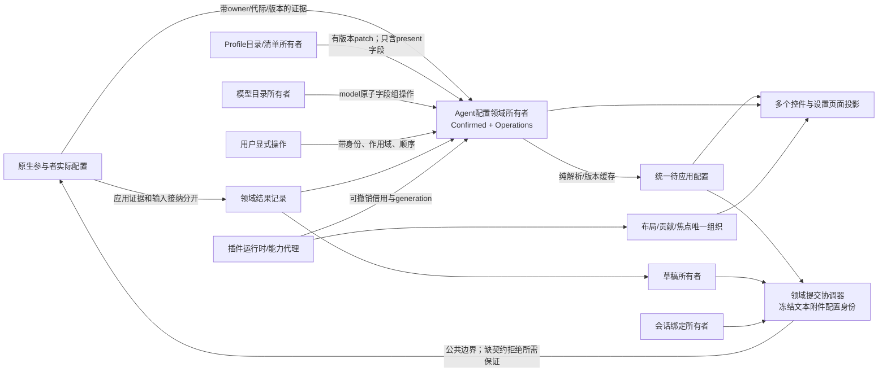

# 状态权威地图

候选模型V1起稿；最终规则以 models/v4.md 为准。以下所有者是目标设计，现有实现证据见inventory，不能宣称已经收束。

“实际配置”由原生参与者拥有；前端Confirmed是该事实唯一带证据的投影所有者，不是假装前端控制实际运行。操作意图不是确认事实；Resolved不是第二份可写配置。

|信息类别/事实|唯一所有者|唯一更新入口|消费者|持久化|生命周期/失效|
|---|---|---|---|---|---|
|原生实际配置|原生/后端领域参与者|其领域操作或自身入口|配置证据接入|既有原生/后端持久层|native generation；前端不重建它|
|Confirmed字段/unknown/lastObserved|AgentConfigurationOwner|校验后的observe/apply evidence|所有配置控件、协调器|仅恢复证据快照，标historical|版本/代际/断连stale|
|用户patch操作/解析结果|同一配置owner|dispatch(opId)，点击时seq|Resolved/应用快照|未发送恢复建议；不存秘密|消费精确opIds，移除source不静默apply|
|Resolved待应用|配置owner纯派生|fold(Confirmed,Operations)|标签、发送快照|不独立持久化|baseRevision+opRevision+catalog/schema版本；全失效重建|
|应用/输入结果|Agent提交领域owner|关联回执/reconcile|配置owner/草稿/错误展示|unknown关联引用需可恢复|terminal非执行成功；UI卸载不删除|
|会话身份/草稿到native映射|AgentSessionOwner|创建/核对绑定证据|配置/交互/历史|既有session/history层|logical身份稳定，native代际替换不冒认|
|运行/审批事实|Agent运行/交互owner|可信参与者事件与操作回执|Chat/原生视图|领域历史层|runId/interactionId/version，输出不能造审批|
|输入文本/附件/光标关联revision|稳定draftId的DraftOwner（composer/window只是attachment）|本地编辑/精确成功消费/显式丢弃|输入/只读预览|未发普通编辑持久化可选；可靠发送恢复路径关联草稿必须持久，禁止存内容则缺恢复保证|稳定draftId；单编辑lease、其他只读；重建attachment不丢|
|未保存设置表单|settings form DraftOwner|编辑/保存结果|该表单|默认不持久|save revision，晚回执不盖新编辑|
|业务设置值|各领域owner|领域save命令/证据|表单与其他视图|原领域存储|领域revision，不归settings registry|
|插件安装/启用清单|装配配置管理|显式配置操作|loader/产品构建|extensions.json既有格式|未启用不装载；空覆盖保持|
|插件激活/贡献/授权lease|runtime/main broker|唯一activate/drain/dispose入口|Workbench、桥、domain access|安装策略持久、运行lease不复用|activation generation、依赖关系、撤销|
|导航/页面选择/布局/overlay/focus|Workbench|组织命令、贡献撤销|呈现层|版本化UI偏好|window scope，触发器失效返回有效内容|
|UI provider可用性/绑定|ui-components|scope注册/撤销、显式选择|所有outlet|产品选择清单，非实例缓存|UI generation独立于领域/native代际|
|目录/资格资料|Profile/model/resource目录owner|查询和目录证据|控件、解析器|既有目录层|版本变化使缓存失效；不追写已捕获操作|
|传输连接/请求映射/缓冲|connections+adapter|open/send/event/close|领域owner|不持配置；安全恢复引用例外|instance identity、link generation，晚resolve清理|
|消息/工具富展示|领域日志owner；view只投影|带来源记录/分页查询|Chat/第三方view|原历史层|renderer缓存有界，未知事件保留gap|

缓存合法条件：只由输入版本生成；缓存键含完整target/contract major/owner generation以及必要native版本；provider移除、目录版本更新、断连、依赖缺席显式失效；清空后从权威重建。缓存不允许作为send输入的第二入口。转换器允许持requestId→opId映射和流cursor，禁止独立pending/lastConfirmed/当前配置。

现有迁移：I01/02 selections/lastConfirmed→配置owner；I03 bindings→session owner，retainedSelections→逻辑目标操作记录，clickQueues→owner序列，glue只贡献；I04 next-turn pending/route→领域owner，client只wire codec；I05组件queued/current→selector投影；I07文本/附件→DraftOwner、发送→领域协调器；I14两注册表→Workbench唯一展示注册，业务设置值不迁入Workbench。
